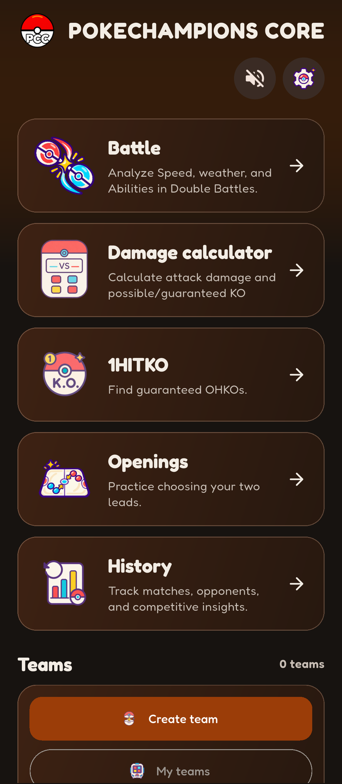
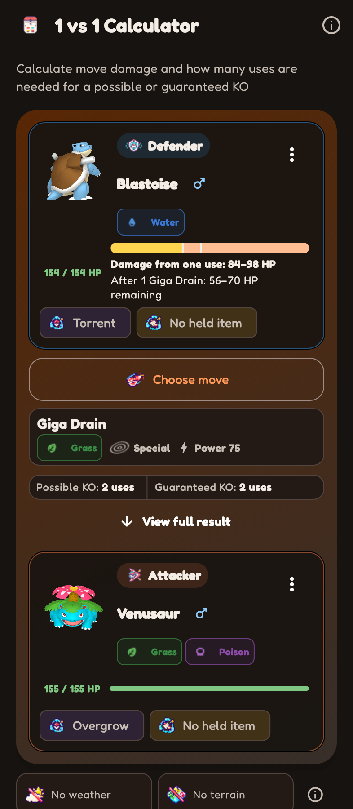
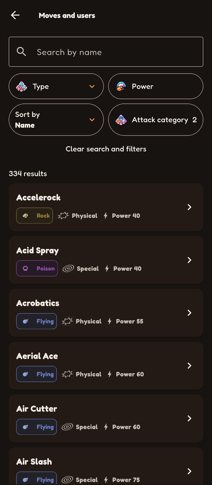

<a href="README.md">Español</a> · <strong>English</strong> · <a href="README.fr.md">Français</a> · <a href="README.de.md">Deutsch</a> · <a href="README.it.md">Italiano</a> · <a href="README.pt.md">Português</a> · <a href="README.ja.md">日本語</a> · <a href="README.ko.md">한국어</a>

# PokeChampions Core

**Prepare your team. Understand the matchup. Learn from your matches.**

Android · Free · No ads · No account · 8 languages

**[Get it on Google Play](https://play.google.com/store/apps/details?id=com.pokechampionscore.external&hl=en)** · [View screenshots](docs/GALLERY.en.md) · [Share feedback](https://github.com/DiegoARRFRA/pokechampions-core-showcase/issues/new/choose)

An Android application for Pokémon Champions players who want to compare damage and speed, explore builds and keep their teams, notes and results together. Its tools and packaged catalogues work **offline**, without an account or automatic Internet synchronisation.

Developed by **[Diego de Arriba](https://github.com/DiegoARRFRA)** · **RakullDev** · Flutter and Dart · Private source code.

[Features](docs/FEATURES.en.md) · [Gallery](docs/GALLERY.en.md) · [How it is built](docs/TECHNICAL_OVERVIEW.en.md) · [Documentation](docs/README.en.md)

## A look at the application

Home, a real Versus calculation and move filters. New screenshots from **14 November 2026**, version **1.0.1**, with the interface in **English**. The gallery identifies the environment for each image. Select one to enlarge it.

[View all eight screenshots and historical demos](docs/GALLERY.en.md). The gallery distinguishes emulator captures, HOST rendering and earlier videos.

[Multilingual review and reproducible cases](docs/SCENARIOS.en.md)

## Get started in three steps

1. **Build a team or save a set in Notes.** Review coverage and keep its ability, nature and SP.
2. **Check a matchup in Versus.** Adjust the attack and conditions; use EV Lab to explore survival or 1HITKO to search for candidates.
3. **Practise and learn.** Rehearse your leads in Lead Trainer and manually save the outcome and observations in History.

## Tools for preparation and comparison

| Tool | What it does |
| --- | --- |
| **Battle** | Analyse doubles scenarios: speed, abilities, weather and effects. Load one or two members from teams, tournaments or notes and temporarily adjust SP/nature. |
| **Versus and EV Lab** | Calculate damage ranges, uses required for a KO and defensive survival spreads; explore conditions with Master Mode. |
| **1HITKO** | Search for KO candidates under the configured scenario, with progress, cancellation and defensive Master Mode. |
| **Teams and Notes** | Build teams, review coverage and reuse saved configurations with ability, nature and SP. |
| **Tournaments and Library** | Explore teams by regulation and date, Smogon builds, STATS, learnsets and move users with combined filters. |
| **Lead Trainer and History** | Practise opening selections and manually record matches, opponents and lessons. |

Battle analyses scenarios; **it does not play out a complete battle**. A guaranteed KO depends on minimum damage and the configured conditions, assuming the move lands. [Scope and limits](docs/FEATURES.en.md).

This review highlights notes grouped by Pokémon, configuration loading across tools, move-category filters, the updated catalogue and current icons. Eight languages, light/dark/system themes and optional audio remain available, including **Tribute to Anime** and **Jojo´s rute**.

## Availability and privacy

**Available on Google Play for Android.** The public listing, checked on **14 November 2026**, describes the app as free, with no ads, in-app purchases or registration. Check the store for the version and compatibility available for your device.

The screenshots show the published **1.0.1** release. Historical test figures retain their own dates and environments.

[Public privacy policy](https://pokechampions-core-privacidad.pages.dev/) · [Author and contact](https://github.com/DiegoARRFRA) · [Feedback and issues](CONTRIBUTING.en.md).

## Frequently asked questions

Does it work offline?

Yes. Calculations, teams, notes and packaged catalogues run locally. Downloading the app, updating it and opening external links require connectivity. New tournament data arrives through app updates.

Where are my teams stored?

On your device. The app does not offer account-based sync or recovery. Read the privacy policy before clearing app data or uninstalling.

Is there an iPhone, web or PC version?

The public download linked here is for Android. Other platforms have no published download in this repository or announced launch date.

How can I help or report a bug?

Open an issue with the app version, device, steps and expected result. For a calculation, include Pokémon, move, ability, item, stats and effects. Feature suggestions and translation corrections are welcome too.

## Under the hood

Flutter/Dart, feature-based organisation and layers, typed contracts and constructor injection. Drift and SQLite store local data in **11 tables**, with transactions, revision checks and migration integrity. Calculation rules are shared across tools; search and storage jobs have separate lifecycles.

**13,706 HOST tests passed, 0 failed and 17 optional omissions**, in the global serial run of **5 November 2026**. Focused checks, emulator updates and historical physical-device tests are documented separately; this count does not certify every device.

[Validation and limits](docs/VALIDATION.en.md) · [Architecture](docs/ARCHITECTURE.en.md) · [Database](docs/DATABASE.en.md) · [Engineering decisions](docs/ENGINEERING.en.md) · [Historical performance](docs/PERFORMANCE.en.md) · [Outstanding work](docs/ROADMAP.en.md).

PokeChampions Core is an unofficial fan project with no affiliation to Nintendo, Creatures, GAME FREAK or The Pokémon Company. Pokémon trademarks and assets belong to their respective rights holders. [Notices and attribution](NOTICE.en.md).
