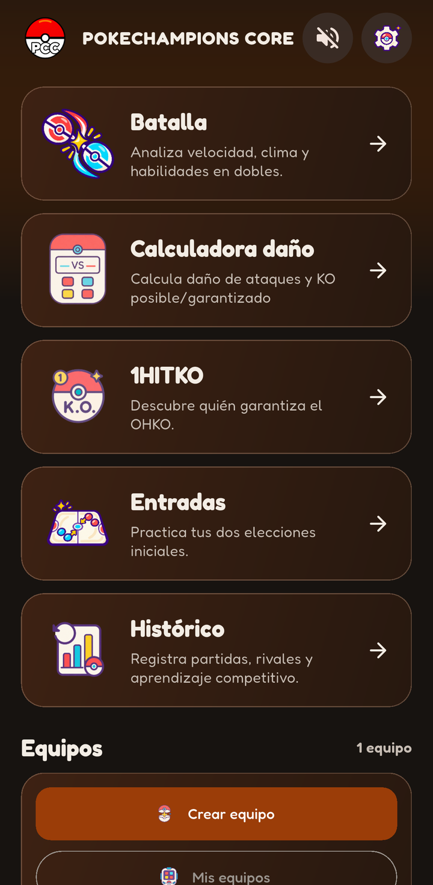
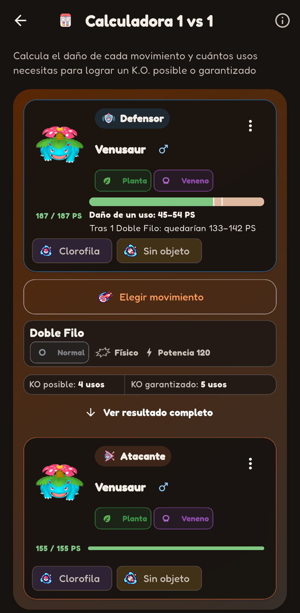
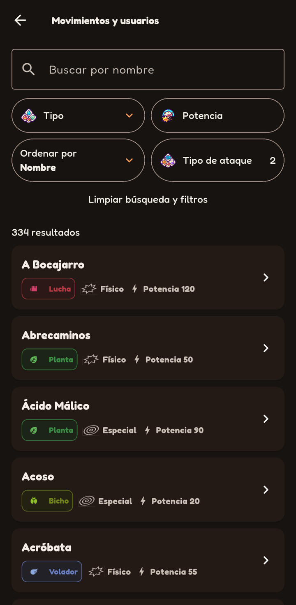

<a href="README.md">Español</a> · <strong>English</strong>

# PokeChampions Core

**Prepare your team. Understand the matchup. Learn from your matches.**

An Android application for Pokémon Champions players who want to compare damage and speed, explore builds and keep their teams, notes and results together. Its tools and packaged catalogues work **offline**, without an account or automatic Internet synchronisation.

Developed by **[Diego de Arriba](https://github.com/DiegoARRFRA)** · Flutter and Dart · Private source code.

[Features](docs/FEATURES.en.md) · [Gallery](docs/GALLERY.en.md) · [How it is built](docs/TECHNICAL_OVERVIEW.en.md) · [Documentation](docs/README.en.md)

## A look at the application

Home, a Versus calculation and move filters. Authentic **1.0.1** screenshots from an Android emulator on **5 November 2026**, showing the Spanish interface. Select an image to view it at full size.

[View all eight screenshots and historical demos](docs/GALLERY.en.md). The gallery distinguishes emulator captures, HOST rendering and earlier videos.

## Tools for preparation and comparison

| Tool | What it does |
| --- | --- |
| **Battle** | Analyse doubles scenarios: speed, abilities, weather and effects. Load one or two members from teams, tournaments or notes and temporarily adjust SP/nature. |
| **Versus and EV Lab** | Calculate damage ranges, uses required for a KO and defensive survival spreads; explore conditions with Master Mode. |
| **1HITKO** | Search for KO candidates under the configured scenario, with progress, cancellation and defensive Master Mode. |
| **Teams and Notes** | Build teams, review coverage and reuse saved configurations with ability, nature and SP. |
| **Tournaments and Library** | Explore teams by regulation and date, Smogon builds, STATS, learnsets and move users with combined filters. |
| **Lead Trainer and History** | Practise opening selections and manually record matches, opponents and lessons. |

Battle analyses scenarios; **it does not play out a complete battle**. A guaranteed KO depends on minimum damage and the configured conditions, assuming the move lands. [Scope and limits](docs/FEATURES.en.md).

This review highlights notes grouped by Pokémon, configuration loading across tools, move-category filters, the updated catalogue and current icons. Eight languages, light/dark/system themes and optional audio remain available, including **Tribute to Anime** and **Jojo´s rute**.

## Availability and privacy

**Version 1.0.1 is in internal testing**, according to the author's update on 5 November 2026. A public download has not been verified, and no closed-testing publication is announced here. This repository contains documentation and selected media, not installers or application source.

[Public privacy policy](https://pokechampions-core-privacidad.pages.dev/) · [Author and contact](https://github.com/DiegoARRFRA) · [Feedback and issues](CONTRIBUTING.en.md).

## Under the hood

Flutter/Dart, feature-based organisation and layers, typed contracts and constructor injection. Drift and SQLite store local data in **11 tables**, with transactions, revision checks and migration integrity. Calculation rules are shared across tools; search and storage jobs have separate lifecycles.

**13,706 HOST tests passed, 0 failed and 17 optional omissions**, in the global serial run of **5 November 2026**. Focused checks, emulator updates and historical physical-device tests are documented separately; this count does not certify every device.

[Validation and limits](docs/VALIDATION.en.md) · [Architecture](docs/ARCHITECTURE.en.md) · [Database](docs/DATABASE.en.md) · [Engineering decisions](docs/ENGINEERING.en.md) · [Historical performance](docs/PERFORMANCE.en.md) · [Outstanding work](docs/ROADMAP.en.md).

PokeChampions Core is an unofficial fan project with no affiliation to Nintendo, Creatures, GAME FREAK or The Pokémon Company. Pokémon trademarks and assets belong to their respective rights holders. [Notices and attribution](NOTICE.en.md).
