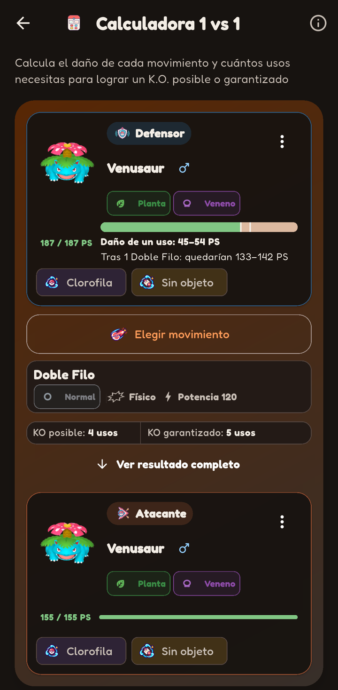

<a href="README.md">Español</a> · <a href="README.en.md">English</a> · <strong>Français</strong> · <a href="README.de.md">Deutsch</a> · <a href="README.it.md">Italiano</a> · <a href="README.pt.md">Português</a> · <a href="README.ja.md">日本語</a> · <a href="README.ko.md">한국어</a>

# PokeChampions Core

**Préparez votre équipe. Comprenez le match-up. Apprenez de vos parties.**

Une application Android pour les joueurs de Pokémon Champions qui souhaitent comparer les dégâts et la Vitesse, explorer des configurations et garder leurs équipes, notes et résultats à portée de main. Ses outils et ses catalogues intégrés fonctionnent **hors ligne**, sans compte ni synchronisation automatique avec Internet.

Développée par **[Diego de Arriba](https://github.com/DiegoARRFRA)** · Flutter et Dart · Code source privé.

[Fonctionnalités](docs/FEATURES.en.md) · [Galerie](docs/GALLERY.en.md) · [Présentation technique](docs/TECHNICAL_OVERVIEW.en.md) · [Documentation](docs/README.en.md)

> Cette présentation est en français. La documentation détaillée est disponible en espagnol et en anglais ; les liens ci-dessus ouvrent la version anglaise.

## Un aperçu de l’application

Écran d’accueil, calcul Versus et filtres de capacités. Captures authentiques de la version **1.0.1**, prises dans un émulateur Android le **5 novembre 2026**, avec l’interface en espagnol. Cliquez sur une image pour l’afficher en taille réelle.

[Voir les huit captures et les démonstrations historiques](docs/GALLERY.en.md). La galerie distingue les captures de l’émulateur, les rendus HOST et les vidéos antérieures.

## Des outils pour préparer et comparer

| Outil | Ce qu’il permet de faire |
| --- | --- |
| **Combat** | Analyser des situations de combat Duo : Vitesse, talents, météo et effets. Charger un ou deux membres depuis des équipes, des tournois ou des notes, puis ajuster temporairement les SP et la nature. |
| **Versus et EV Lab** | Calculer les plages de dégâts, le nombre d’utilisations nécessaires pour un K.O. et les répartitions défensives permettant de survivre ; explorer les conditions avec le mode Maître. |
| **1HITKO** | Rechercher des candidats capables d’infliger un K.O. selon le scénario configuré, avec suivi de progression, annulation et mode Maître défensif. |
| **Équipes et notes** | Créer des équipes, consulter leur couverture défensive et réutiliser des configurations enregistrées avec talent, nature et SP. |
| **Tournois et bibliothèque** | Explorer les équipes par règlement et date, les configurations Smogon, les STATS, les capacités apprises et les Pokémon pouvant les apprendre, avec des filtres combinables. |
| **Entraînement aux leads et historique** | S’entraîner au choix des Pokémon de départ et consigner manuellement les parties, adversaires et enseignements. |

Combat analyse des scénarios ; **il ne simule pas un combat complet**. Un K.O. garanti dépend des dégâts minimaux et des conditions configurées, en supposant que la capacité touche. [Portée et limites — anglais](docs/FEATURES.en.md).

Cette révision met en avant les notes regroupées par Pokémon, le chargement de configurations entre outils, les filtres par catégorie de capacité, le catalogue mis à jour et les icônes actuelles. Huit langues restent disponibles : espagnol, anglais, français, allemand, italien, portugais, japonais et coréen. Les thèmes clair, sombre et système ainsi que l’audio facultatif sont également disponibles, notamment **Tribute to Anime** et **Jojo´s rute**.

## Disponibilité et confidentialité

**Version 1.0.1 en test interne**, selon l’état communiqué par l’auteur le 5 novembre 2026. Le téléchargement public n’a pas été vérifié dans cette revue et aucune publication en test fermé n’y est annoncée. Ce dépôt contient de la documentation et des médias de présentation, pas d’installateurs ni de code source de l’application.

[Politique de confidentialité publique](https://pokechampions-core-privacidad.pages.dev/) · [Auteur et contact](https://github.com/DiegoARRFRA) · [Retours et problèmes — anglais](CONTRIBUTING.en.md).

## Sous le capot

Flutter/Dart, organisation par fonctionnalités et par couches, contrats typés et injection par constructeur. Drift et SQLite stockent les données locales dans **11 tables**, avec transactions, contrôles de révision et intégrité des migrations. Les règles de calcul sont partagées entre les outils ; les tâches de recherche et de stockage ont des cycles de vie distincts.

**13 706 tests HOST réussis, 0 échec et 17 tests facultatifs ignorés**, lors de l’exécution globale séquentielle du **5 novembre 2026**. Les vérifications ciblées, la mise à jour dans l’émulateur et les essais historiques sur appareils physiques sont documentés séparément ; ce total ne certifie pas tous les appareils.

Documentation technique en anglais : [Validation et limites](docs/VALIDATION.en.md) · [Architecture](docs/ARCHITECTURE.en.md) · [Base de données](docs/DATABASE.en.md) · [Choix d’ingénierie](docs/ENGINEERING.en.md) · [Performances historiques](docs/PERFORMANCE.en.md) · [Travaux restants](docs/ROADMAP.en.md).

PokeChampions Core est un projet de fan non officiel, sans affiliation avec Nintendo, Creatures, GAME FREAK ou The Pokémon Company. Les marques et ressources Pokémon appartiennent à leurs titulaires respectifs. [Mentions et attributions — anglais](NOTICE.en.md).
