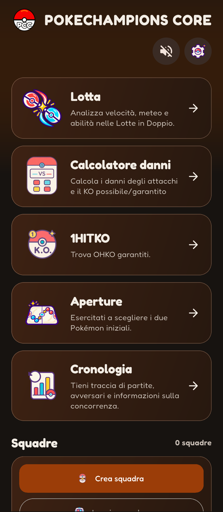
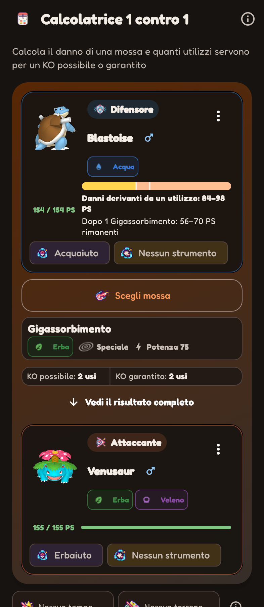
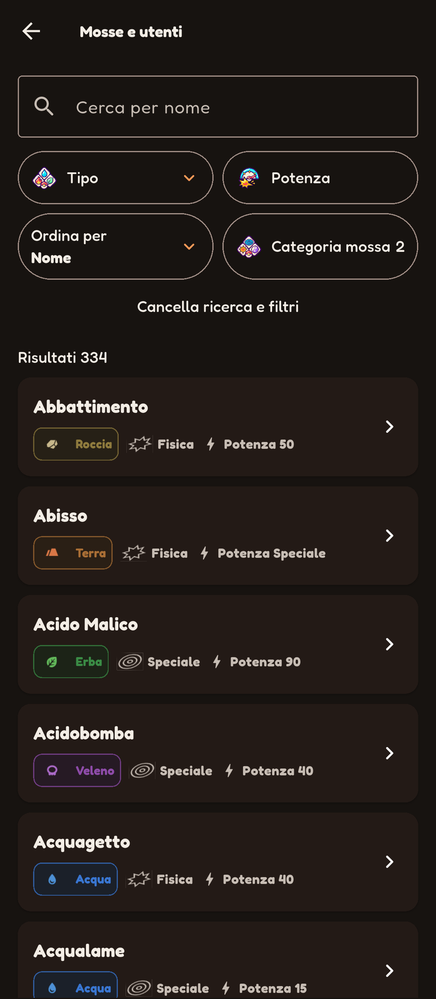

<a href="README.md">Español</a> · <a href="README.en.md">English</a> · <a href="README.fr.md">Français</a> · <a href="README.de.md">Deutsch</a> · <strong>Italiano</strong> · <a href="README.pt.md">Português</a> · <a href="README.ja.md">日本語</a> · <a href="README.ko.md">한국어</a>

# PokeChampions Core

**Prepara la tua squadra. Comprendi il confronto. Impara dalle tue partite.**

Android · Gratis · Senza pubblicità · Senza account · 8 lingue

**[Scarica su Google Play](https://play.google.com/store/apps/details?id=com.pokechampionscore.external&hl=it)** · [Guarda gli screenshot](docs/GALLERY.it.md) · [Invia un suggerimento](https://github.com/DiegoARRFRA/pokechampions-core-showcase/issues/new/choose)

Un’app Android per i giocatori di Pokémon Champions che vogliono confrontare danni e Velocità, esplorare configurazioni e avere sempre con sé squadre, note e risultati. Gli strumenti e i cataloghi inclusi funzionano **offline**, senza account né sincronizzazione automatica con Internet.

Sviluppata da **[Diego de Arriba](https://github.com/DiegoARRFRA)** · **RakullDev** · Flutter e Dart · Codice sorgente privato.

[Funzionalità](docs/FEATURES.en.md) · [Galleria](docs/GALLERY.it.md) · [Panoramica tecnica](docs/TECHNICAL_OVERVIEW.en.md) · [Documentazione](docs/README.en.md)

> Anche la galleria è disponibile in italiano. I documenti tecnici dettagliati sono in spagnolo e inglese; gli altri link alla documentazione di questa pagina aprono la versione inglese.

## Uno sguardo all’app

Home, un calcolo reale in Versus e filtri delle mosse. Nuove immagini del **14 novembre 2026**, versione **1.0.1**, con interfaccia in **italiano**. La galleria indica l’ambiente di ogni immagine. Seleziona un’immagine per ingrandirla.

[Visualizza tutti gli otto screenshot e le demo storiche](docs/GALLERY.it.md). La galleria distingue le acquisizioni dall’emulatore, i rendering HOST e i video precedenti.

[Verifica multilingue e casi riproducibili — inglese](docs/SCENARIOS.en.md)

## Inizia in tre passaggi

1. **Crea una squadra o salva un set nelle note.** Controlla la copertura e conserva abilità, natura e SP.
2. **Verifica un confronto in Versus.** Regola attacco e condizioni; usa EV Lab per esplorare la sopravvivenza o 1HITKO per cercare candidati.
3. **Allenati e impara.** Esercitati con i lead e salva manualmente risultato e osservazioni nella cronologia.

## Strumenti per preparare e confrontare

| Strumento | Cosa permette di fare |
| --- | --- |
| **Lotta** | Analizzare scenari di lotta in doppio: Velocità, abilità, meteo ed effetti. Caricare uno o due membri da squadre, tornei o note e modificare temporaneamente SP e natura. |
| **Versus ed EV Lab** | Calcolare intervalli di danno, utilizzi necessari per un K.O. e distribuzioni difensive per sopravvivere; esplorare le condizioni con la modalità Maestro. |
| **1HITKO** | Cercare candidati al K.O. nello scenario configurato, con avanzamento, annullamento e modalità Maestro difensiva. |
| **Squadre e note** | Creare squadre, consultarne la copertura difensiva e riutilizzare configurazioni salvate con abilità, natura e SP. |
| **Tornei e biblioteca** | Esplorare squadre per regolamento e data, configurazioni Smogon, STATS, mosse apprendibili e Pokémon che le imparano, con filtri combinabili. |
| **Allenamento dei lead e cronologia** | Esercitarsi nella scelta dei Pokémon iniziali e registrare manualmente partite, avversari e lezioni apprese. |

Lotta analizza scenari; **non simula una lotta completa**. Un K.O. garantito dipende dal danno minimo e dalle condizioni configurate, supponendo che la mossa vada a segno. [Ambito e limiti — inglese](docs/FEATURES.en.md).

Questa revisione mette in evidenza le note raggruppate per Pokémon, il caricamento di configurazioni tra strumenti, i filtri per categoria di mossa, il catalogo aggiornato e le icone attuali. Restano disponibili otto lingue: spagnolo, inglese, francese, tedesco, italiano, portoghese, giapponese e coreano. Sono inoltre disponibili i temi chiaro, scuro e di sistema e l’audio facoltativo, inclusi **Tribute to Anime** e **Jojo´s rute**.

## Disponibilità e privacy

**Disponibile su Google Play per Android.** La scheda pubblica, verificata il **14 novembre 2026**, presenta l’app come gratuita, senza pubblicità, acquisti in-app o registrazione. Consulta lo store per la versione e la compatibilità disponibili per il tuo dispositivo.

Le immagini mostrano la versione pubblica **1.0.1**. I dati storici dei test conservano le proprie date e i propri ambienti.

[Informativa sulla privacy pubblica](https://pokechampions-core-privacidad.pages.dev/) · [Autore e contatti](https://github.com/DiegoARRFRA) · [Feedback e segnalazioni — inglese](CONTRIBUTING.en.md).

## Domande frequenti

Funziona offline?

Sì. Calcoli, squadre, note e cataloghi inclusi funzionano localmente. Download, aggiornamenti e link esterni richiedono una connessione. I nuovi dati dei tornei arrivano con gli aggiornamenti dell’app.

Dove vengono salvate le mie squadre?

Sul dispositivo. L’app non offre sincronizzazione o recupero tramite account. Consulta l’informativa sulla privacy prima di cancellare i dati o disinstallare l’app.

Esiste una versione per iPhone, web o PC?

Il download pubblico qui indicato è per Android. Questo repository non offre download per altre piattaforme e non è stata annunciata una data di uscita.

Come posso aiutare o segnalare un errore?

Apri una issue con versione, dispositivo, passaggi e risultato atteso. Per un calcolo, includi Pokémon, mossa, abilità, strumento, statistiche ed effetti. Sono benvenuti anche suggerimenti e correzioni delle traduzioni.

## Dietro le quinte

Flutter/Dart, organizzazione per funzionalità e livelli, contratti tipizzati e iniezione tramite costruttore. Drift e SQLite archiviano i dati locali in **11 tabelle**, con transazioni, controlli di revisione e integrità delle migrazioni. Le regole di calcolo sono condivise tra gli strumenti; le attività di ricerca e archiviazione hanno cicli di vita separati.

**13.706 test HOST superati, 0 falliti e 17 test facoltativi saltati**, nell’esecuzione globale seriale del **5 novembre 2026**. Le verifiche mirate, l’aggiornamento nell’emulatore e i test storici su dispositivi fisici sono documentati separatamente; questo totale non certifica tutti i dispositivi.

Documentazione tecnica in inglese: [Validazione e limiti](docs/VALIDATION.en.md) · [Architettura](docs/ARCHITECTURE.en.md) · [Database](docs/DATABASE.en.md) · [Scelte ingegneristiche](docs/ENGINEERING.en.md) · [Prestazioni storiche](docs/PERFORMANCE.en.md) · [Attività aperte](docs/ROADMAP.en.md).

PokeChampions Core è un progetto amatoriale non ufficiale, senza affiliazione con Nintendo, Creatures, GAME FREAK o The Pokémon Company. I marchi e le risorse Pokémon appartengono ai rispettivi titolari. [Avvisi e attribuzioni — inglese](NOTICE.en.md).
