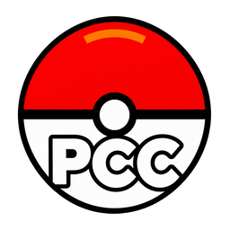
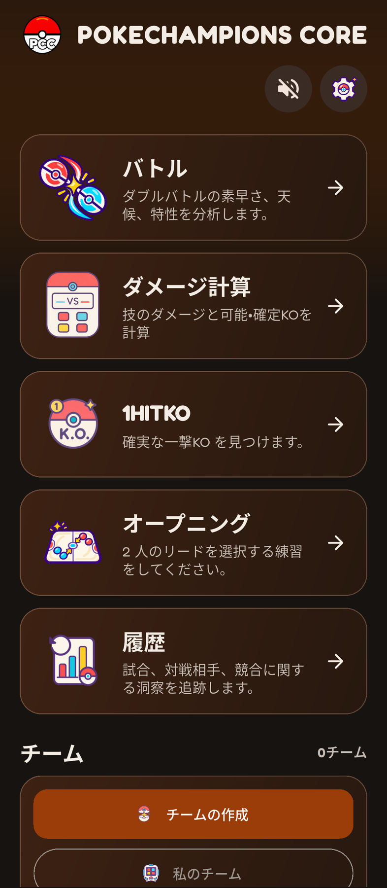
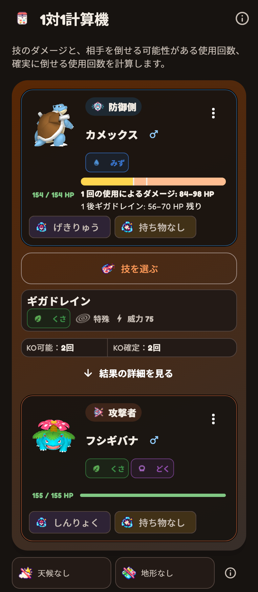
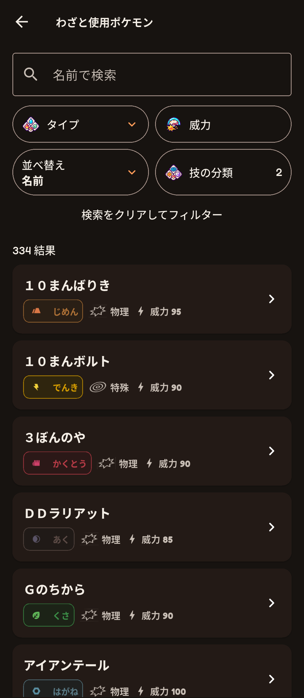

<a href="README.md">Español</a> · <a href="README.en.md">English</a> · <a href="README.fr.md">Français</a> · <a href="README.de.md">Deutsch</a> · <a href="README.it.md">Italiano</a> · <a href="README.pt.md">Português</a> · <strong>日本語</strong> · <a href="README.ko.md">한국어</a>

# PokeChampions Core

**チームを準備する。対面を理解する。対戦から学ぶ。**

Android · 無料 · 広告なし · アカウント不要 · 8言語対応

**[Google Play でダウンロード](https://play.google.com/store/apps/details?id=com.pokechampionscore.external&hl=ja)** · [スクリーンショットを見る](docs/GALLERY.ja.md) · [フィードバックを送る](https://github.com/DiegoARRFRA/pokechampions-core-showcase/issues/new/choose)

Pokémon Champions のプレイヤー向け Android アプリです。ダメージや素早さを比較し、構成を検討しながら、チーム・メモ・対戦記録をまとめて管理できます。各ツールと同梱カタログは **オフライン** で動作し、アカウント登録やインターネットとの自動同期は必要ありません。

開発者：**[Diego de Arriba](https://github.com/DiegoARRFRA)** · **RakullDev** · Flutter / Dart · ソースコード非公開。

[機能](docs/FEATURES.en.md) · [ギャラリー](docs/GALLERY.ja.md) · [技術概要](docs/TECHNICAL_OVERVIEW.en.md) · [ドキュメント](docs/README.en.md)

> ギャラリーも日本語で読めます。詳細な技術ドキュメントはスペイン語と英語で公開しており、このページのその他のドキュメントリンクは英語版に移動します。

## アプリの画面

ホーム、Versusの実際の計算結果、技の絞り込みを紹介します。**2026年11月14日**に撮影したバージョン**1.0.1**の新しい画像で、画面は**日本語**です。各画像の実行環境はギャラリーに記載しています。画像を選択すると拡大できます。

[8枚すべてのスクリーンショットと過去のデモを見る](docs/GALLERY.ja.md)。ギャラリーでは、エミュレーターの画像、HOST レンダリング、過去の動画を区別して掲載しています。

[多言語の検証と再現可能なケース — 英語](docs/SCENARIOS.en.md)

## 3ステップで始める

1. **チームを作成するか、メモに構成を保存します。** タイプ相性を確認し、特性・性格・SPを記録しましょう。
2. **Versus で対面を確認します。** 攻撃と条件を調整し、EV Lab で耐久配分を検討したり、1HITKO で候補を探したりできます。
3. **練習して振り返ります。** 先発の選択を練習し、結果と気づいたことを対戦履歴に手動で保存しましょう。

## 準備と比較のためのツール

| ツール | できること |
| --- | --- |
| **バトル** | ダブルバトルの状況を分析し、素早さ・特性・天候・各種効果を確認します。保存済みチーム、大会のチーム、メモから1〜2匹を読み込み、SPや性格を一時的に変更できます。 |
| **Versus / EV Lab** | ダメージ範囲、KOに必要な攻撃回数、生存に必要な耐久配分を計算します。マスターモードでは条件の影響を比較できます。 |
| **1HITKO** | 設定した状況で一撃KOが可能な候補を検索します。進捗表示、キャンセル、防御側のマスターモードに対応しています。 |
| **チームとメモ** | チームを作成し、防御面のタイプ相性を確認し、特性・性格・SPを含む保存済み構成を再利用できます。 |
| **大会とライブラリー** | レギュレーションや日付で大会のチームを探せます。Smogon の構成、STATS、習得技、各技を覚えるポケモンを組み合わせ可能なフィルターで調べられます。 |
| **先発練習と対戦履歴** | 先発の選択を練習し、対戦・相手・学んだことを手動で記録できます。 |

バトルは状況を分析するツールであり、**対戦全体を進行するシミュレーターではありません**。確定KOは、技が命中することを前提に、最小ダメージと設定した条件から判定されます。[対応範囲と制限 — 英語](docs/FEATURES.en.md)。

今回の更新では、ポケモン別にまとめたメモ、ツール間での構成の読み込み、技分類フィルター、更新済みカタログ、現在のアイコンを紹介しています。対応言語はスペイン語、英語、フランス語、ドイツ語、イタリア語、ポルトガル語、日本語、韓国語の8言語です。ライト・ダーク・システム設定に合わせたテーマと、任意の音声再生も利用できます。音声には **Tribute to Anime** と **Jojo´s rute** が含まれます。

## 公開状況とプライバシー

**Android 向けに Google Play で公開中です。** **2026年11月14日**に確認した公開ストアページでは、無料・広告なし・アプリ内課金なし・登録不要と案内されています。お使いの端末で利用できるバージョンと対応状況は、ストアで確認してください。

画像は公開版**1.0.1**の画面です。過去のテスト結果の数値は、それぞれの実施日と実行環境に基づくものです。

[公開プライバシーポリシー](https://pokechampions-core-privacidad.pages.dev/) · [開発者と連絡先](https://github.com/DiegoARRFRA) · [フィードバックと不具合報告 — 英語](CONTRIBUTING.en.md)。

## よくある質問

オフラインで使えますか？

はい。計算、チーム、メモ、同梱カタログは端末内で利用できます。アプリのダウンロード、更新、外部リンクの表示には通信が必要です。新しい大会データはアプリの更新で追加されます。

チームはどこに保存されますか？

端末内に保存されます。アカウントによる同期や復元機能はありません。アプリのデータを削除したりアンインストールしたりする前に、プライバシーポリシーをご確認ください。

iPhone・Web・PC版はありますか？

ここで案内している一般公開ダウンロードは Android 版です。このリポジトリでは、他のプラットフォーム向けのダウンロードや公開予定日は案内していません。

不具合の報告や開発への協力はできますか？

Issue にアプリのバージョン、端末、再現手順、期待した結果を記載してください。計算については、ポケモン、技、特性、持ち物、ステータス、各種効果も必要です。機能の提案や翻訳の修正も歓迎します。

## 内部の仕組み

Flutter / Dart を使用し、機能ごと・レイヤーごとに整理した構成、型付きの契約、コンストラクター注入を採用しています。Drift と SQLite により、トランザクション、リビジョン確認、マイグレーションの整合性を備えた **11個のテーブル** にローカルデータを保存します。計算ルールはツール間で共有し、検索処理と保存処理はそれぞれ独立したライフサイクルを持ちます。

**2026年11月5日**の全体直列実行で、**HOSTテスト13,706件が成功、失敗0件、任意の17件をスキップ**しました。個別の検証、エミュレーターでの更新、過去の実機テストは別途記録しています。この件数は、すべての端末での動作を保証するものではありません。

英語の技術ドキュメント：[検証と制限](docs/VALIDATION.en.md) · [アーキテクチャー](docs/ARCHITECTURE.en.md) · [データベース](docs/DATABASE.en.md) · [設計上の判断](docs/ENGINEERING.en.md) · [過去の性能測定](docs/PERFORMANCE.en.md) · [今後の課題](docs/ROADMAP.en.md)。

PokeChampions Core は非公式のファンプロジェクトであり、Nintendo、Creatures、GAME FREAK、The Pokémon Company とは関係ありません。Pokémon の商標と素材の権利は、それぞれの権利者に帰属します。[権利表記とクレジット — 英語](NOTICE.en.md)。
