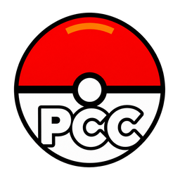
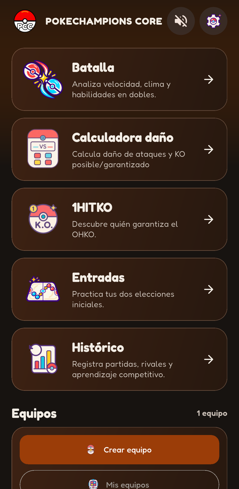
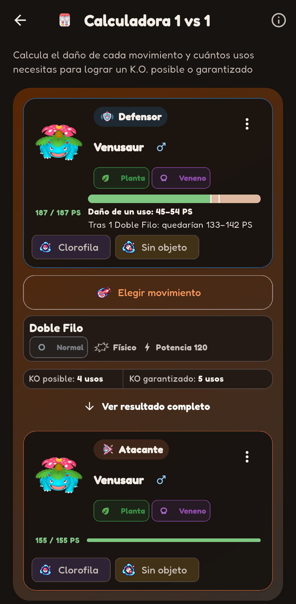
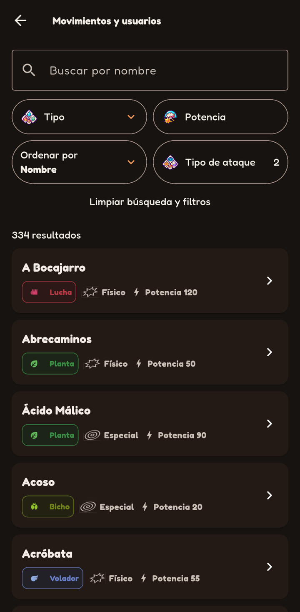

<strong>Español</strong> · <a href="README.en.md">English</a>

# PokeChampions Core

**Prepara tu equipo. Entiende el enfrentamiento. Aprende de tus partidas.**

Una aplicación Android para jugadores de Pokémon Champions que quieren comparar daño y velocidades, explorar configuraciones y llevar sus equipos, notas y resultados consigo. Sus herramientas y catálogos funcionan **offline**, sin cuenta ni sincronización automática con Internet.

Desarrollada por **[Diego de Arriba](https://github.com/DiegoARRFRA)** · Flutter y Dart · Código privado.

[Funciones](docs/FEATURES.md) · [Galería](docs/GALLERY.md) · [Cómo está construida](docs/TECHNICAL_OVERVIEW.md) · [Documentación](docs/README.md)

## Una mirada a la aplicación

Inicio, un cálculo de Versus y filtros de movimientos. Capturas auténticas de **1.0.1**, en emulador Android, del **5 de noviembre de 2026**; interfaz en español. Pulsa para verlas a tamaño completo.

[Ver las ocho capturas y las demos históricas](docs/GALLERY.md). La galería identifica por separado emulador, renderizado HOST y vídeos anteriores.

## Herramientas para preparar y comparar

| Herramienta | Qué permite hacer |
| --- | --- |
| **Batalla** | Analizar escenarios de dobles: velocidad, habilidades, clima y efectos. Cargar uno o dos integrantes desde equipos, torneos o notas y ajustar SP/naturaleza temporalmente. |
| **Versus y EV Lab** | Calcular rangos de daño, usos necesarios para KO y repartos defensivos de supervivencia; explorar condiciones con Modo Maestro. |
| **1HITKO** | Buscar candidatos de KO bajo el escenario configurado, con progreso, cancelación y Modo Maestro defensivo. |
| **Equipos y notas** | Crear equipos, consultar cobertura y reutilizar configuraciones guardadas con habilidad, naturaleza y SP. |
| **Torneos y Biblioteca** | Explorar equipos por regulación y fecha, builds de Smogon, STATS, movimientos aprendidos y usuarios con filtros combinables. |
| **Entradas e Histórico** | Practicar elecciones iniciales y registrar manualmente partidas, rivales y aprendizajes. |

Batalla analiza escenarios; **no juega un combate completo**. Un KO garantizado depende del daño mínimo y de las condiciones configuradas, suponiendo que el movimiento impacta. [Alcance y límites](docs/FEATURES.md).

En esta revisión destacan las notas agrupadas por Pokémon, la carga de configuraciones entre herramientas, los filtros de categoría de movimiento, el catálogo actualizado y los iconos actuales. Se mantienen ocho idiomas, temas claro/oscuro/sistema y audio opcional, incluidas **Tribute to Anime** y **Jojo´s rute**.

## Disponibilidad y privacidad

**Versión 1.0.1 en pruebas internas**, según el estado comunicado por el autor el 5 de noviembre de 2026. No se ha verificado una descarga pública ni se anuncia una publicación en pruebas cerradas. Este repositorio contiene documentación y muestras, no instaladores ni código de la aplicación.

[Política de privacidad pública](https://pokechampions-core-privacidad.pages.dev/) · [Contacto y autor](https://github.com/DiegoARRFRA) · [Comentarios e incidencias](CONTRIBUTING.md).

## Por dentro

Flutter/Dart, organización por funcionalidades y capas, contratos tipados e inyección por constructor. Drift y SQLite almacenan los datos locales en **11 tablas**, con transacciones, revisiones e integridad de migraciones. Las reglas de cálculo se comparten entre herramientas; los trabajos de búsqueda y almacenamiento tienen ciclos de vida separados.

**13.706 pruebas HOST aprobadas, 0 fallos y 17 omisiones opcionales**, en la ejecución global serial del **5 de noviembre de 2026**. Las pruebas focales, la actualización en emulador y las pruebas físicas históricas se documentan por separado; ese total no certifica todos los dispositivos.

[Validación y límites](docs/VALIDATION.md) · [Arquitectura](docs/ARCHITECTURE.md) · [Base de datos](docs/DATABASE.md) · [Decisiones de ingeniería](docs/ENGINEERING.md) · [Rendimiento histórico](docs/PERFORMANCE.md) · [Pendientes](docs/ROADMAP.md).

PokeChampions Core es un proyecto fan no oficial, sin afiliación con Nintendo, Creatures, GAME FREAK ni The Pokémon Company. Las marcas y recursos Pokémon pertenecen a sus titulares. [Avisos y atribuciones](NOTICE.md).
