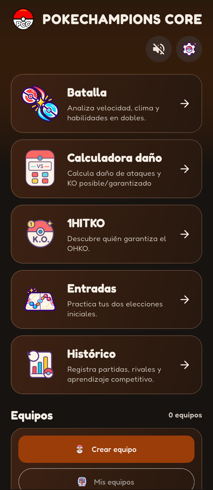
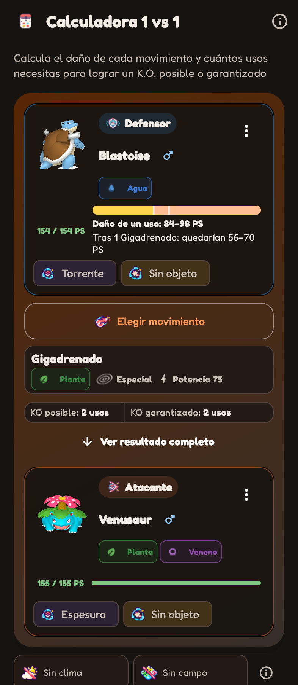
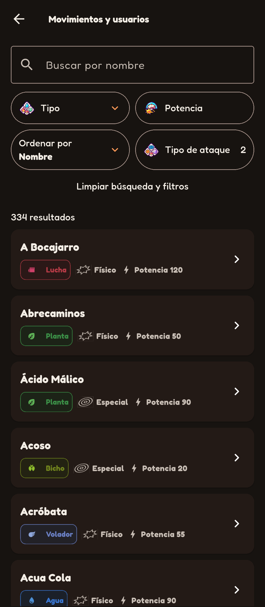

<strong>Español</strong> · <a href="README.en.md">English</a> · <a href="README.fr.md">Français</a> · <a href="README.de.md">Deutsch</a> · <a href="README.it.md">Italiano</a> · <a href="README.pt.md">Português</a> · <a href="README.ja.md">日本語</a> · <a href="README.ko.md">한국어</a>

# PokeChampions Core

**Prepara tu equipo. Entiende el enfrentamiento. Aprende de tus partidas.**

Android · Gratis · Sin anuncios · Sin cuenta · 8 idiomas

**[Descargar en Google Play](https://play.google.com/store/apps/details?id=com.pokechampionscore.external&hl=es)** · [Ver capturas](docs/GALLERY.md) · [Enviar una sugerencia](https://github.com/DiegoARRFRA/pokechampions-core-showcase/issues/new/choose)

Una aplicación Android para jugadores de Pokémon Champions que quieren comparar daño y velocidades, explorar configuraciones y llevar sus equipos, notas y resultados consigo. Sus herramientas y catálogos funcionan **offline**, sin cuenta ni sincronización automática con Internet.

Desarrollada por **[Diego de Arriba](https://github.com/DiegoARRFRA)** · **RakullDev** · Flutter y Dart · Código privado.

[Funciones](docs/FEATURES.md) · [Galería](docs/GALLERY.md) · [Cómo está construida](docs/TECHNICAL_OVERVIEW.md) · [Documentación](docs/README.md)

## Una mirada a la aplicación

Inicio, un cálculo real de Versus y filtros de movimientos. Capturas nuevas del **14 de noviembre de 2026**, versión **1.0.1**, con la interfaz en **español**. La galería identifica el entorno de cada imagen. Pulsa para ampliarlas.

[Ver las ocho capturas y las demos históricas](docs/GALLERY.md). La galería identifica por separado emulador, renderizado HOST y vídeos anteriores.

[Revisión multilingüe y casos reproducibles](docs/SCENARIOS.md)

## Empieza en tres pasos

1. **Crea un equipo o guarda un set en Notas.** Revisa su cobertura y conserva habilidad, naturaleza y SP.
2. **Comprueba un enfrentamiento en Versus.** Ajusta el ataque y las condiciones; usa EV Lab para explorar supervivencia o 1HITKO para buscar candidatos.
3. **Practica y aprende.** Ensaya tus leads en Entradas y guarda manualmente el resultado y tus observaciones en Histórico.

## Herramientas para preparar y comparar

| Herramienta | Qué permite hacer |
| --- | --- |
| **Batalla** | Analizar escenarios de dobles: velocidad, habilidades, clima y efectos. Cargar uno o dos integrantes desde equipos, torneos o notas y ajustar SP/naturaleza temporalmente. |
| **Versus y EV Lab** | Calcular rangos de daño, usos necesarios para KO y repartos defensivos de supervivencia; explorar condiciones con Modo Maestro. |
| **1HITKO** | Buscar candidatos de KO bajo el escenario configurado, con progreso, cancelación y Modo Maestro defensivo. |
| **Equipos y notas** | Crear equipos, consultar cobertura y reutilizar configuraciones guardadas con habilidad, naturaleza y SP. |
| **Torneos y Biblioteca** | Explorar equipos por regulación y fecha, builds de Smogon, STATS, movimientos aprendidos y usuarios con filtros combinables. |
| **Entradas e Histórico** | Practicar elecciones iniciales y registrar manualmente partidas, rivales y aprendizajes. |

Batalla analiza escenarios; **no juega un combate completo**. Un KO garantizado depende del daño mínimo y de las condiciones configuradas, suponiendo que el movimiento impacta. [Alcance y límites](docs/FEATURES.md).

En esta revisión destacan las notas agrupadas por Pokémon, la carga de configuraciones entre herramientas, los filtros de categoría de movimiento, el catálogo actualizado y los iconos actuales. Se mantienen ocho idiomas, temas claro/oscuro/sistema y audio opcional, incluidas **Tribute to Anime** y **Jojo´s rute**.

## Disponibilidad y privacidad

**Disponible en Google Play para Android.** La ficha pública, comprobada el **14 de noviembre de 2026**, presenta la app como gratuita, sin anuncios, sin compras integradas y sin registro. Consulta la tienda para conocer la versión y la compatibilidad disponibles para tu dispositivo.

Las capturas muestran la entrega pública **1.0.1**. Las cifras históricas de pruebas conservan sus fechas y entornos propios.

[Política de privacidad pública](https://pokechampions-core-privacidad.pages.dev/) · [Contacto y autor](https://github.com/DiegoARRFRA) · [Comentarios e incidencias](CONTRIBUTING.md).

## Preguntas frecuentes

¿Funciona sin Internet?

Sí. Los cálculos, equipos, notas y catálogos se utilizan localmente. Descargar la app, actualizarla y abrir enlaces externos requiere conexión. Los nuevos datos de torneos llegan con las actualizaciones de la app.

¿Dónde se guardan mis equipos?

En el dispositivo. La app no ofrece sincronización ni recuperación mediante una cuenta. Consulta la política de privacidad antes de borrar los datos de la app o desinstalarla.

¿Existe una versión para iPhone, web o PC?

La descarga pública enlazada aquí es para Android. Las demás plataformas no tienen una descarga publicada en este repositorio ni una fecha de lanzamiento anunciada.

¿Cómo puedo ayudar o comunicar un fallo?

Abre una incidencia con la versión de la app, tu dispositivo, los pasos y el resultado esperado. Para un cálculo, incluye Pokémon, movimiento, habilidad, objeto, estadísticas y efectos. También puedes sugerir mejoras o correcciones de traducción.

## Por dentro

Flutter/Dart, organización por funcionalidades y capas, contratos tipados e inyección por constructor. Drift y SQLite almacenan los datos locales en **11 tablas**, con transacciones, revisiones e integridad de migraciones. Las reglas de cálculo se comparten entre herramientas; los trabajos de búsqueda y almacenamiento tienen ciclos de vida separados.

**13.706 pruebas HOST aprobadas, 0 fallos y 17 omisiones opcionales**, en la ejecución global serial del **5 de noviembre de 2026**. Las pruebas focales, la actualización en emulador y las pruebas físicas históricas se documentan por separado; ese total no certifica todos los dispositivos.

[Validación y límites](docs/VALIDATION.md) · [Arquitectura](docs/ARCHITECTURE.md) · [Base de datos](docs/DATABASE.md) · [Decisiones de ingeniería](docs/ENGINEERING.md) · [Rendimiento histórico](docs/PERFORMANCE.md) · [Pendientes](docs/ROADMAP.md).

PokeChampions Core es un proyecto fan no oficial, sin afiliación con Nintendo, Creatures, GAME FREAK ni The Pokémon Company. Las marcas y recursos Pokémon pertenecen a sus titulares. [Avisos y atribuciones](NOTICE.md).
