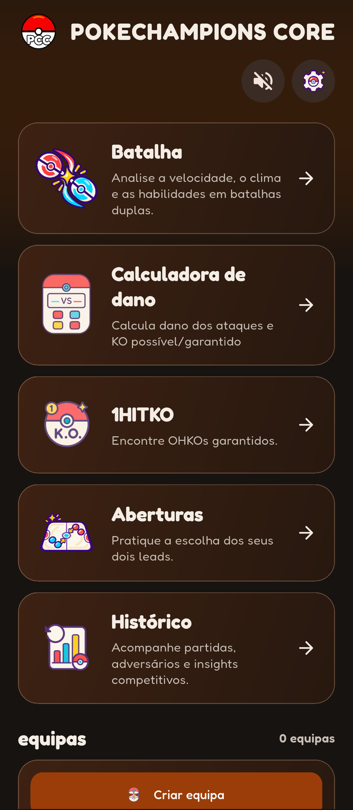
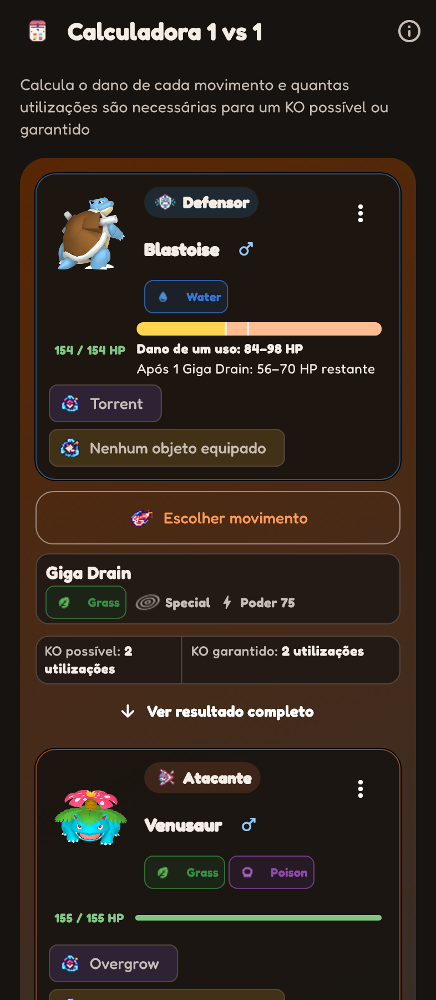
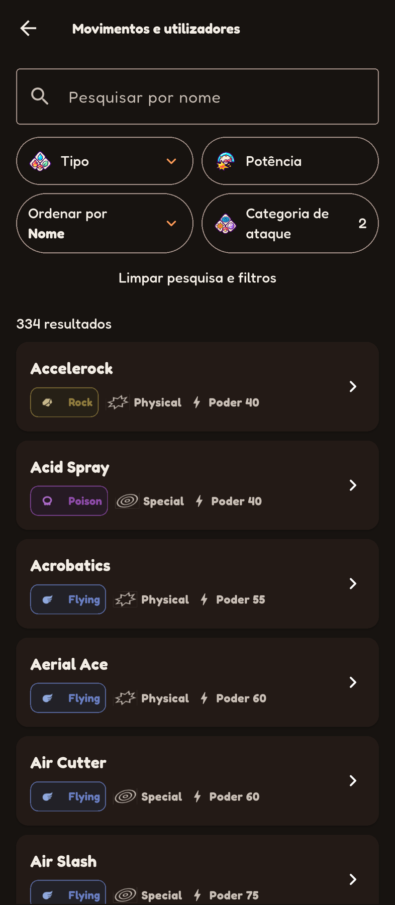

<a href="README.md">Español</a> · <a href="README.en.md">English</a> · <a href="README.fr.md">Français</a> · <a href="README.de.md">Deutsch</a> · <a href="README.it.md">Italiano</a> · <strong>Português</strong> · <a href="README.ja.md">日本語</a> · <a href="README.ko.md">한국어</a>

# PokeChampions Core

**Prepara a tua equipa. Compreende o confronto. Aprende com as tuas partidas.**

Android · Grátis · Sem anúncios · Sem conta · 8 idiomas

**[Descarregar no Google Play](https://play.google.com/store/apps/details?id=com.pokechampionscore.external&hl=pt)** · [Ver capturas](docs/GALLERY.pt.md) · [Enviar uma sugestão](https://github.com/DiegoARRFRA/pokechampions-core-showcase/issues/new/choose)

Uma aplicação Android para jogadores de Pokémon Champions que querem comparar dano e Velocidade, explorar configurações e ter sempre consigo as suas equipas, notas e resultados. As ferramentas e os catálogos incluídos funcionam **offline**, sem conta nem sincronização automática com a Internet.

Desenvolvida por **[Diego de Arriba](https://github.com/DiegoARRFRA)** · **RakullDev** · Flutter e Dart · Código-fonte privado.

[Funcionalidades](docs/FEATURES.en.md) · [Galeria](docs/GALLERY.pt.md) · [Visão técnica](docs/TECHNICAL_OVERVIEW.en.md) · [Documentação](docs/README.en.md)

> A galeria também está disponível em português. Os documentos técnicos detalhados estão em espanhol e inglês; as restantes ligações à documentação nesta página abrem a versão inglesa.

## Um olhar sobre a aplicação

Início, um cálculo real no Versus e filtros de movimentos. Novas capturas de **14 de novembro de 2026**, versão **1.0.1**, com interface em **português de Portugal**. A galeria identifica o ambiente de cada imagem. Seleciona uma imagem para a ampliar.

[Ver as oito capturas e as demonstrações históricas](docs/GALLERY.pt.md). A galeria distingue as capturas do emulador, as renderizações HOST e os vídeos anteriores.

[Revisão multilingue e casos reproduzíveis — inglês](docs/SCENARIOS.en.md)

## Começa em três passos

1. **Cria uma equipa ou guarda uma configuração nas notas.** Revê a cobertura e conserva habilidade, natureza e SP.
2. **Analisa um confronto no Versus.** Ajusta o ataque e as condições; usa o EV Lab para explorar a sobrevivência ou o 1HITKO para procurar candidatos.
3. **Pratica e aprende.** Treina os teus leads e guarda manualmente o resultado e as observações no histórico.

## Ferramentas para preparar e comparar

| Ferramenta | O que permite fazer |
| --- | --- |
| **Batalha** | Analisar cenários de batalhas em duplas: Velocidade, habilidades, clima e efeitos. Carregar um ou dois membros de equipas, torneios ou notas e ajustar temporariamente SP e natureza. |
| **Versus e EV Lab** | Calcular intervalos de dano, utilizações necessárias para um KO e distribuições defensivas para sobreviver; explorar condições com o Modo Mestre. |
| **1HITKO** | Procurar candidatos a KO no cenário configurado, com progresso, cancelamento e Modo Mestre defensivo. |
| **Equipas e notas** | Criar equipas, consultar a cobertura defensiva e reutilizar configurações guardadas com habilidade, natureza e SP. |
| **Torneios e biblioteca** | Explorar equipas por regulamento e data, configurações Smogon, STATS, movimentos aprendidos e Pokémon que os podem aprender, com filtros combináveis. |
| **Treino de leads e histórico** | Praticar a escolha dos Pokémon iniciais e registar manualmente partidas, adversários e aprendizagens. |

Batalha analisa cenários; **não simula uma batalha completa**. Um KO garantido depende do dano mínimo e das condições configuradas, supondo que o movimento acerta. [Âmbito e limites — inglês](docs/FEATURES.en.md).

Esta revisão destaca as notas agrupadas por Pokémon, o carregamento de configurações entre ferramentas, os filtros por categoria de movimento, o catálogo atualizado e os ícones atuais. Continuam disponíveis oito idiomas: espanhol, inglês, francês, alemão, italiano, português, japonês e coreano. Mantêm-se também os temas claro, escuro e do sistema e o áudio opcional, incluindo **Tribute to Anime** e **Jojo´s rute**.

## Disponibilidade e privacidade

**Disponível no Google Play para Android.** A ficha pública, consultada em **14 de novembro de 2026**, apresenta a aplicação como gratuita, sem anúncios, compras integradas ou registo. Consulta a loja para saberes a versão e a compatibilidade disponíveis para o teu dispositivo.

As capturas mostram a versão pública **1.0.1**. Os números históricos dos testes mantêm as respetivas datas e ambientes.

[Política de privacidade pública](https://pokechampions-core-privacidad.pages.dev/) · [Autor e contacto](https://github.com/DiegoARRFRA) · [Sugestões e problemas — inglês](CONTRIBUTING.en.md).

## Perguntas frequentes

Funciona sem Internet?

Sim. Cálculos, equipas, notas e catálogos incluídos funcionam localmente. As transferências, atualizações e ligações externas precisam de Internet. Os novos dados de torneios chegam com as atualizações da aplicação.

Onde ficam guardadas as minhas equipas?

No dispositivo. A aplicação não oferece sincronização nem recuperação através de uma conta. Consulta a política de privacidade antes de apagar os dados ou desinstalar a aplicação.

Existe uma versão para iPhone, web ou PC?

A transferência pública indicada aqui é para Android. Este repositório não disponibiliza transferências para outras plataformas nem anuncia uma data de lançamento.

Como posso ajudar ou comunicar um erro?

Abre uma issue com a versão, o dispositivo, os passos e o resultado esperado. Para um cálculo, inclui Pokémon, movimento, habilidade, item, estatísticas e efeitos. Também podes sugerir melhorias ou corrigir traduções.

## Por dentro

Flutter/Dart, organização por funcionalidades e camadas, contratos tipados e injeção pelo construtor. Drift e SQLite guardam os dados locais em **11 tabelas**, com transações, verificações de revisão e integridade das migrações. As regras de cálculo são partilhadas entre ferramentas; as tarefas de pesquisa e armazenamento têm ciclos de vida separados.

**13 706 testes HOST aprovados, 0 falhas e 17 testes opcionais ignorados**, na execução global sequencial de **5 de novembro de 2026**. As verificações específicas, a atualização no emulador e os testes históricos em dispositivos físicos estão documentados separadamente; este total não certifica todos os dispositivos.

Documentação técnica em inglês: [Validação e limites](docs/VALIDATION.en.md) · [Arquitetura](docs/ARCHITECTURE.en.md) · [Base de dados](docs/DATABASE.en.md) · [Decisões de engenharia](docs/ENGINEERING.en.md) · [Desempenho histórico](docs/PERFORMANCE.en.md) · [Trabalho pendente](docs/ROADMAP.en.md).

PokeChampions Core é um projeto de fãs não oficial, sem afiliação à Nintendo, Creatures, GAME FREAK ou The Pokémon Company. As marcas e os recursos Pokémon pertencem aos respetivos titulares. [Avisos e atribuições — inglês](NOTICE.en.md).
