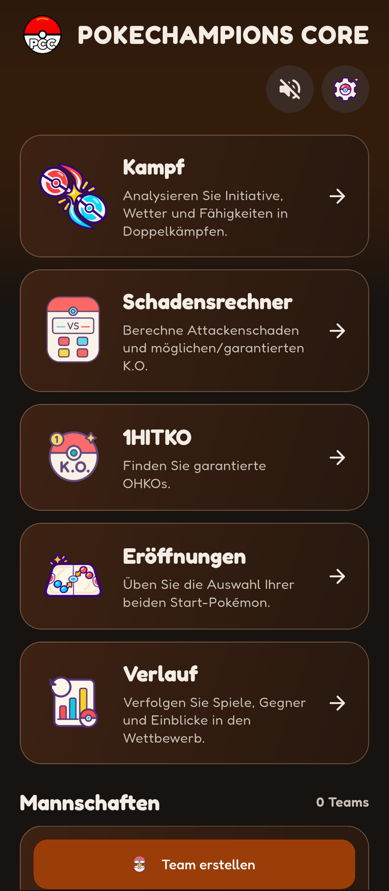
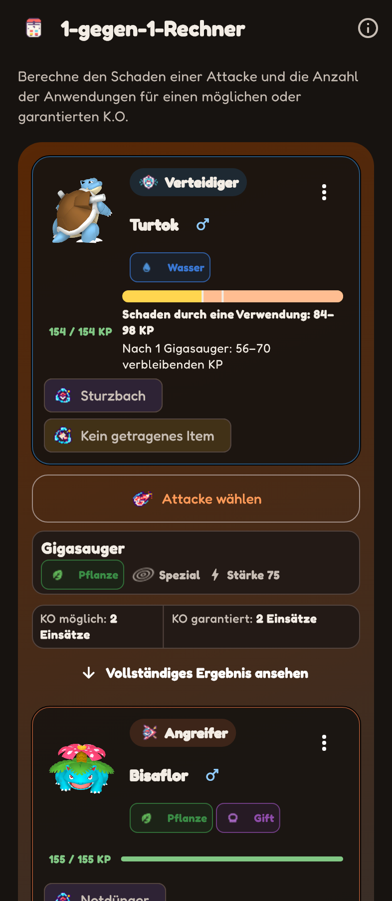
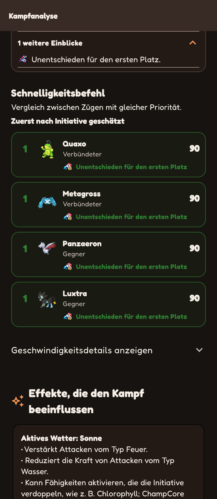
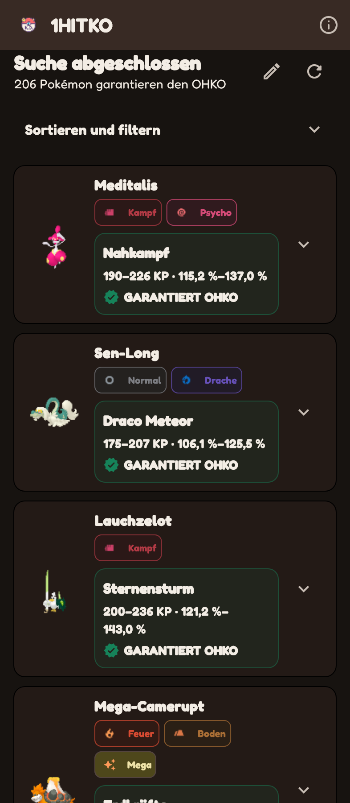
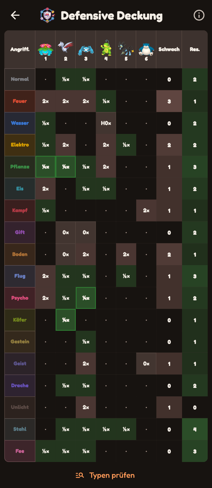
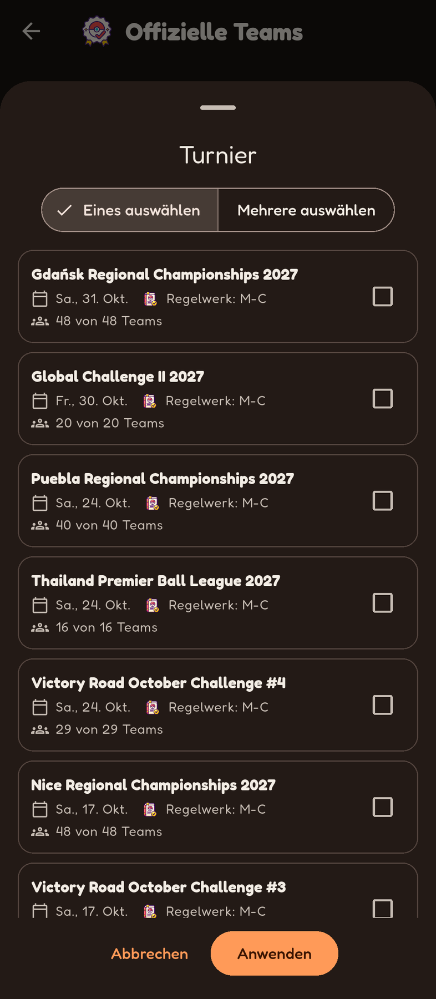
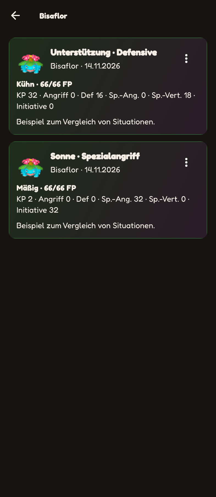
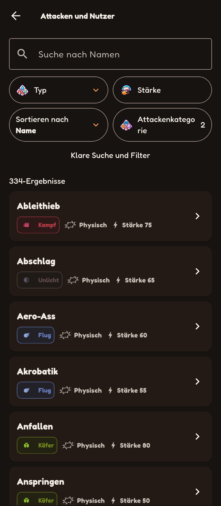

<a href="GALLERY.md">Español</a> · <a href="GALLERY.en.md">English</a> · <a href="GALLERY.fr.md">Français</a> · <strong>Deutsch</strong> · <a href="GALLERY.it.md">Italiano</a> · <a href="GALLERY.pt.md">Português</a> · <a href="GALLERY.ja.md">日本語</a> · <a href="GALLERY.ko.md">한국어</a>

# PokeChampions Core · Galerie

[← Übersicht](../README.de.md) · [Funktionen — Englisch](FEATURES.en.md) · [Dokumentation — Englisch](README.en.md)

Acht neue Aufnahmen vom **14. November 2026** aus Version **1.0.1**, mit **deutscher** Oberfläche. **HOST** bezeichnet echte Flutter-Widgets unter Windows mit den Katalogen und der Berechnungslogik dieser Version sowie isolierten Beispieldaten. **Android-Emulator** bezeichnet Release 1.0.1/46 auf API 36 x86_64. Bildunterschriften und Manifest nennen die Herkunft; kein Bild stammt von einem physischen Smartphone.

Alle acht Sprachen verwenden dieselben Pokémon und Einstellungen. Die Bearbeitung beschränkt sich auf das gegebenenfalls nötige Entfernen der Systemleisten, proportionale Verkleinerung und WebP-Kompression. Keine generierten Oberflächen oder übersetzten Pixel. [Fälle und Grenzen — Englisch](SCENARIOS.en.md) · [Herkunft — Englisch](../media/README.en.md).

## Startseite und Schaden

- **Startseite · Android emulator.** Aktuelles Logo und Werkzeuge im dunklen Design.
- **Versus · HOST.** Bisaflor setzt Gigasauger gegen Turtok ein: 84–98 KP Schaden und möglicher sowie garantierter K.O. bei zwei berechneten Einsätzen.

## Szenarien und Suche

- **Kampf · HOST.** Bekannte Initiative und manuell gewähltes Sonnenlicht in einer Doppelkampf-Situation. Es werden keine Runden ausgeführt.
- **1HITKO · HOST.** Abgeschlossene Suche gegen Briduradon: 206 Kandidaten in diesem Szenario, mit Filtern und Sortierung. Keine allgemeingültige Gesamtzahl.

## Teams und Herkunft

- **Defensive Abdeckung · HOST.** Defensive Matrix eines fiktiven Teams mit sechs Mitgliedern: Schwächen, Resistenzen und Immunitäten.
- **Turniere · Android emulator.** Enthaltener Turnierkatalog mit Datum und historischem Regelwerk. Saisonbezeichnungen können 2027 enthalten.

## Sets und Nachschlagen

- **Notizen · HOST.** Zwei fiktive Bisaflor-Konfigurationen mit Wesen und SP. Keine Wettbewerbsempfehlungen.
- **Bibliothek · Android emulator.** Attacken und Anwender mit Physisch und Spezial ausgewählt: 334 Ergebnisse in diesem Katalog.

## Historische Videodemos

Diese sieben stummen MP4-Clips wurden im **September 2026** vorbereitet. Ihre Bytes sind unverändert; die genauen App-Builds sind nicht verifiziert. Sie zeigen frühere Abläufe, keine neuen Funktionen von 1.0.1 oder aktuellen Leistungsmessungen. Klicke auf ein Vorschaubild oder einen Link; es gibt keine automatische Wiedergabe.

| Demo | Dauer | Kontext |
| --- | ---: | --- |
| [Versus](../media/demos/versus.mp4) | 12.6 s | 22/09/2026 · Build nicht verifiziert |
| [EV Lab](../media/demos/ev-lab.mp4) | 16.8 s | 22/09/2026 · Build nicht verifiziert |
| [1HITKO](../media/demos/1hitko.mp4) | 13 s | 17/09/2026 · Build nicht verifiziert |
| [Teams und Sets](../media/demos/team-builder.mp4) | 21 s | 22/09/2026 · Build nicht verifiziert |
| [Lead-Trainer](../media/demos/entradas.mp4) | 10 s | 22/09/2026 · Build nicht verifiziert |
| [Verlauf](../media/demos/history.mp4) | 9.2 s | 22/09/2026 · Build nicht verifiziert |
| [Sprachen](../media/demos/languages.mp4) | 13.9 s | 22/09/2026 · Build nicht verifiziert |

Ergebnisse im Lead-Trainer und im Verlauf werden manuell eingegeben. Ältere Medien können frühere Symbole und Bedienelemente zeigen. Das Medienmanifest bestätigt keine Berechnungsgenauigkeit.

[Validierung — Englisch](VALIDATION.en.md) · [Medieninventar — Englisch](../media/README.en.md) · [Rechte — Englisch](../NOTICE.en.md)
