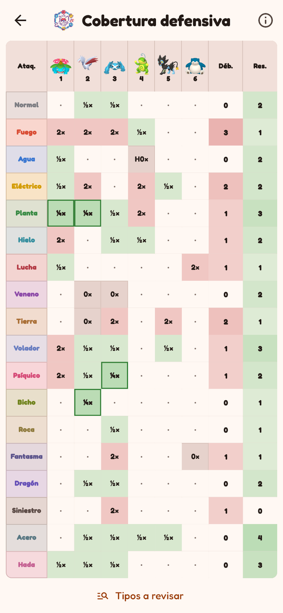

<a href="GALLERY.md">Español</a> · <a href="GALLERY.en.md">English</a> · <a href="GALLERY.fr.md">Français</a> · <strong>Deutsch</strong> · <a href="GALLERY.it.md">Italiano</a> · <a href="GALLERY.pt.md">Português</a> · <a href="GALLERY.ja.md">日本語</a> · <a href="GALLERY.ko.md">한국어</a>

# PokeChampions Core · Galerie

[← Übersicht](../README.de.md) · [Funktionen — Englisch](FEATURES.en.md) · [Dokumentation — Englisch](README.en.md)

Acht echte Screenshots vom **5. November 2026** mit spanischer Oberfläche. **Android-Emulator** bezeichnet Version 1.0.1/46 auf API 36 x86_64. **HOST** bezeichnet echte Flutter-Widgets, die unter Windows aus dem Quellstand dieser Version mit fiktiven Daten gerendert wurden. Für diese Bildserie wurde kein physisches Smartphone verwendet. Ein Klick öffnet die volle Auflösung.

Bei Emulator-Aufnahmen wurden nur Systemleisten entfernt. HOST-Bilder enthalten keine Android-Systemoberfläche. Alle Bilder wurden verkleinert, nie vergrößert; weder Oberfläche noch Ergebnisse wurden nachgebaut. [Herkunft und Verarbeitung — Englisch](../media/README.en.md).

## Startseite und Schaden

- **Startseite · Android-Emulator.** Aktuelles Logo und Werkzeugverknüpfungen im dunklen Design.
- **Versus · Android-Emulator.** Risikotackle: 45–54 KP Schaden sowie Einsätze für einen möglichen und garantierten K.O.

## Szenarien und Suche

- **Kampf · HOST.** Tatsächliche Analyse von Einwechselwetter und Initiative; unbekannte SP ergeben Bereiche und einen geschätzten Gleichstand.
- **1HITKO · Android-Emulator.** Gescrollte Ansicht nach abgeschlossener Suche: 206 Kandidaten in diesem Szenario sowie Sortier- und Filteroptionen. Keine allgemeingültige Anzahl.

## Teams und Herkunft

- **Defensive Abdeckung · HOST.** Matrix eines beispielhaften Teams aus sechs Mitgliedern: Schwächen, Resistenzen und Antworten nach Typ.
- **Turniere · Android-Emulator.** Turnierauswahl mit Datum, historischem Regelwerk und Mehrfachauswahl. Die Angaben 2027 gehören zu offiziellen Veranstaltungsnamen der Saison.

## Sets und Nachschlagen

- **Notizen · HOST.** Zwei fiktive Bisaflor-Sets in ihrer Gruppe mit Wesen und SP-Verteilung. Keine Empfehlungen für den Wettkampf.
- **Bibliothek · Android-Emulator.** Attacken und ihre Nutzer mit zwei aktiven Kategorien: 334 Ergebnisse in dieser Auswahl.

## Historische Videodemos

Diese sieben stummen MP4-Clips wurden im **September 2026** vorbereitet. Ihre Bytes sind unverändert; die genauen App-Builds sind nicht verifiziert. Sie zeigen frühere Abläufe, keine neuen Funktionen von 1.0.1 oder aktuellen Leistungsmessungen. Klicke auf ein Vorschaubild oder einen Link; es gibt keine automatische Wiedergabe.

| Demo | Dauer | Kontext |
| --- | ---: | --- |
| [Versus](../media/demos/versus.mp4) | 12.6 s | 22/09/2026 · Build nicht verifiziert |
| [EV Lab](../media/demos/ev-lab.mp4) | 16.8 s | 22/09/2026 · Build nicht verifiziert |
| [1HITKO](../media/demos/1hitko.mp4) | 13 s | 17/09/2026 · Build nicht verifiziert |
| [Teams und Sets](../media/demos/team-builder.mp4) | 21 s | 22/09/2026 · Build nicht verifiziert |
| [Lead-Trainer](../media/demos/entradas.mp4) | 10 s | 22/09/2026 · Build nicht verifiziert |
| [Verlauf](../media/demos/history.mp4) | 9.2 s | 22/09/2026 · Build nicht verifiziert |
| [Sprachen](../media/demos/languages.mp4) | 13.9 s | 22/09/2026 · Build nicht verifiziert |

Ergebnisse im Lead-Trainer und im Verlauf werden manuell eingegeben. Ältere Medien können frühere Symbole und Bedienelemente zeigen. Das Medienmanifest bestätigt keine Berechnungsgenauigkeit.

[Validierung — Englisch](VALIDATION.en.md) · [Medieninventar — Englisch](../media/README.en.md) · [Rechte — Englisch](../NOTICE.en.md)
