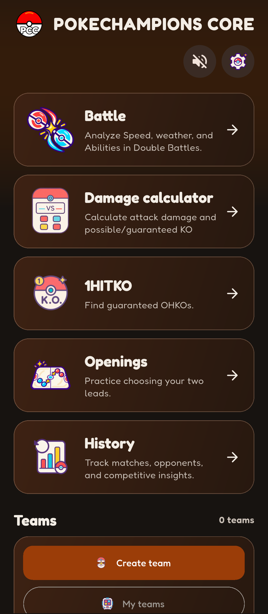
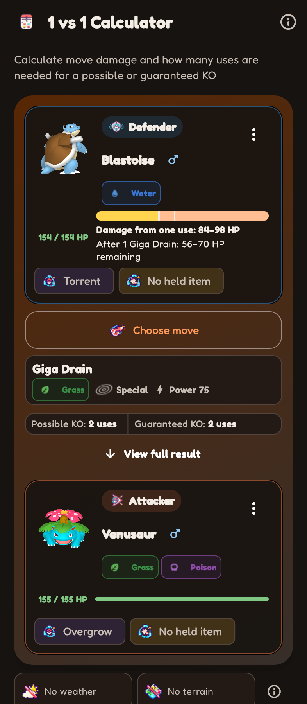
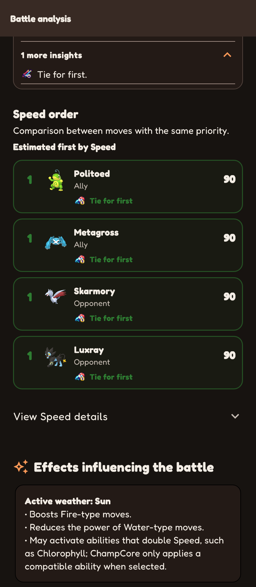
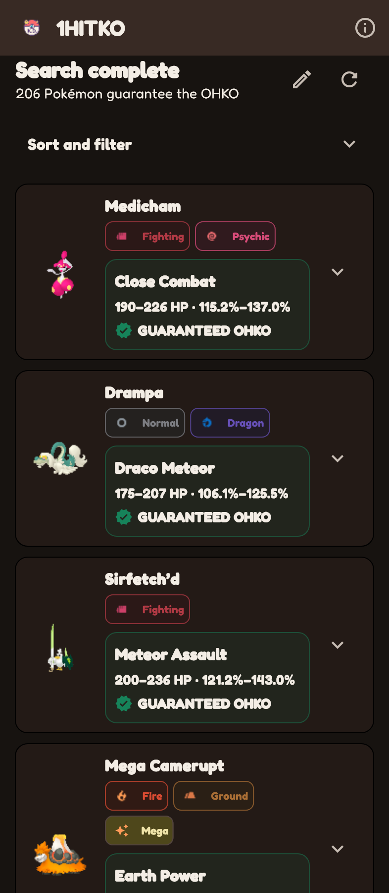
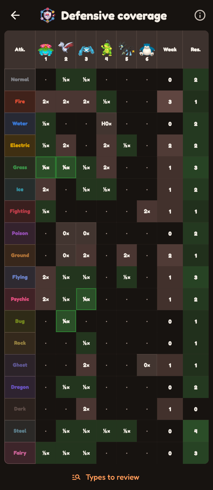
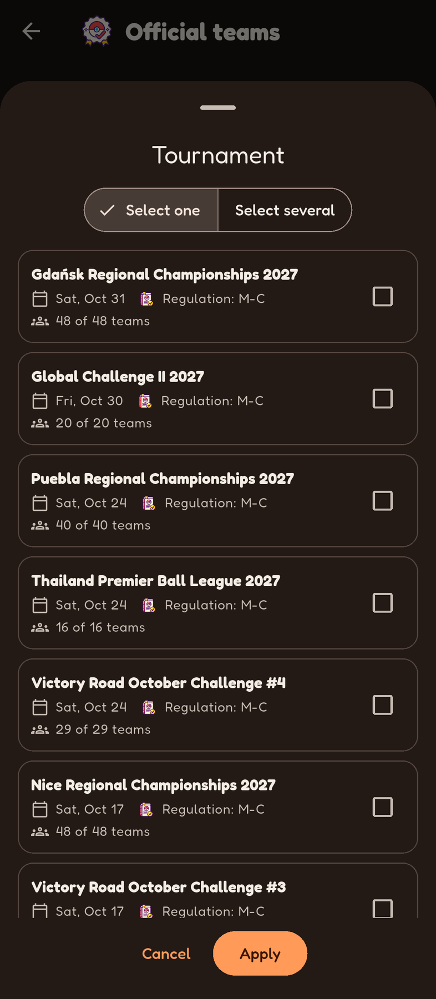
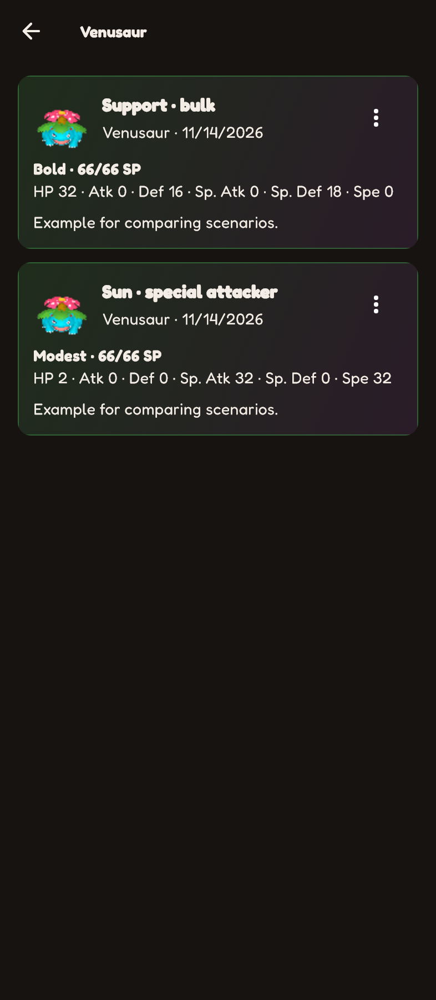
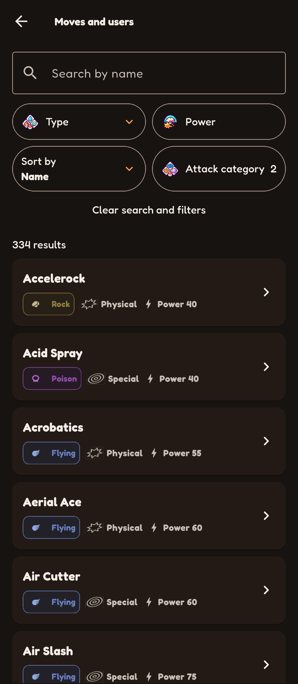
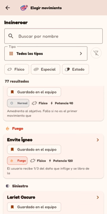
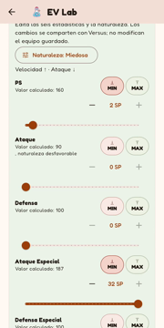

<a href="GALLERY.md">Español</a> · <strong>English</strong> · <a href="GALLERY.fr.md">Français</a> · <a href="GALLERY.de.md">Deutsch</a> · <a href="GALLERY.it.md">Italiano</a> · <a href="GALLERY.pt.md">Português</a> · <a href="GALLERY.ja.md">日本語</a> · <a href="GALLERY.ko.md">한국어</a>

# PokeChampions Core · Gallery

[← Overview](../README.en.md) · [Features](FEATURES.en.md) · [Documentation](README.en.md)

Eight new screenshots from **14 November 2026**, with the interface in **English**, from **1.0.1**. **HOST** means real Flutter widgets rendered on Windows with that release's catalogs and engine and isolated synthetic data. **Android emulator** means release 1.0.1/46 on API 36 x86_64. Each caption and the manifest identify its origin; none is a physical-phone screenshot.

The same Pokémon and configurations are used across all eight languages. Processing is limited to system-bar cropping where applicable, proportional downscaling and WebP compression. No generated interfaces or translated pixels. [Cases and limits](SCENARIOS.en.md) · [Provenance](../media/README.en.md).

## Home and damage

- **Home · Android emulator.** Current logo and tools in the dark theme.
- **Versus · HOST.** Venusaur uses Giga Drain against Blastoise: 84–98 HP and possible and guaranteed KO in two calculated uses.

## Scenarios and search

- **Battle · HOST.** Known Speed and manually selected sun in a doubles scenario. No turns are executed.
- **1HITKO · HOST.** Completed search against Archaludon: 206 candidates in this scenario, with filters and sorting. Not a universal total.

## Teams and provenance

- **Defensive coverage · HOST.** Defensive matrix for a synthetic six-member team: weaknesses, resistances and immunities.
- **Tournaments · Android emulator.** Packaged tournament catalog with event dates and historical regulations. Season names may include 2027.

## Configurations and reference

- **Notes · HOST.** Two synthetic Venusaur configurations with nature and SP. These are not competitive recommendations.
- **Library · Android emulator.** Moves and users with Physical and Special selected: 334 results in this catalog.

## Historical video demos

These seven silent MP4 clips were prepared in **September 2026**, before this refresh. They are retained byte for byte; their exact application builds are unverified. They demonstrate earlier flows, not new 1.0.1 features or current performance. Select a thumbnail or video link; nothing autoplays.

| Demo | Duration | Context |
| --- | ---: | --- |
| [Versus](../media/demos/versus.mp4) | 12.6 s | 22/09/2026 · unverified build |
| [EV Lab](../media/demos/ev-lab.mp4) | 16.8 s | 22/09/2026 · unverified build |
| [1HITKO](../media/demos/1hitko.mp4) | 13 s | 17/09/2026 · unverified build |
| [Teams and builds](../media/demos/team-builder.mp4) | 21 s | 22/09/2026 · unverified build |
| [Lead Trainer](../media/demos/entradas.mp4) | 10 s | 22/09/2026 · unverified build |
| [History](../media/demos/history.mp4) | 9.2 s | 22/09/2026 · unverified build |
| [Languages](../media/demos/languages.mp4) | 13.9 s | 22/09/2026 · unverified build |

Lead Trainer outcomes and History results in demos are entered manually. Historical media may show older icons and controls. The current feature description is in [Features](FEATURES.en.md); the media manifest does not certify calculation accuracy.

[Validation](VALIDATION.en.md) · [Media inventory](../media/README.en.md) · [Ownership](../NOTICE.en.md)
