
<a href="GALLERY.md">Español</a> · <strong>English</strong>

# PokeChampions Core · Gallery

[← Overview](../README.en.md) · [Features](FEATURES.en.md) · [Documentation](README.en.md)

Eight authentic screenshots from **5 November 2026**, Spanish UI. **Android emulator** identifies release 1.0.1/46 on API 36 x86_64; **HOST** identifies real Flutter widgets rendered on Windows from that release's source snapshot, with fictional data. No physical phone was used for this refresh. Select an image to view full resolution.

Only system bars were cropped from emulator images. HOST images contain no Android system chrome. All were downscaled, never enlarged; no interface or result was reconstructed. [Provenance and processing](../media/README.en.md).

## Home and damage

<a href="../media/screenshots/home.png">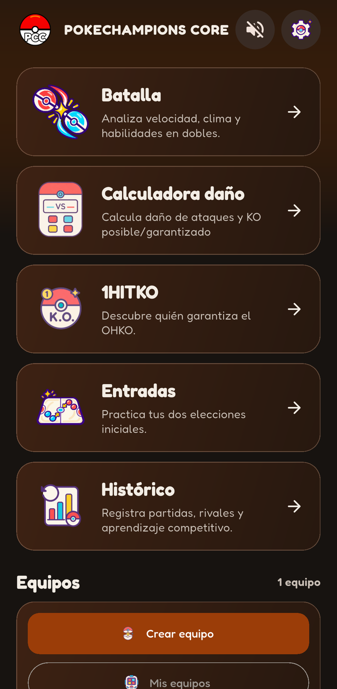</a>
<a href="../media/screenshots/versus-result.png">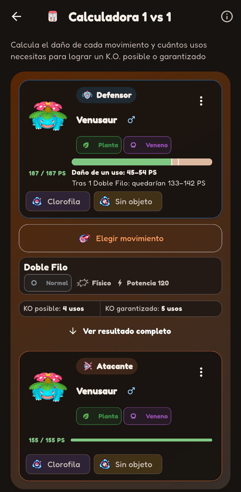</a>

- **Home · Android emulator.** Current logo and tool shortcuts in the dark theme.
- **Versus · Android emulator.** Double-Edge: 45–54 HP damage, with uses for possible and guaranteed KO.

## Scenarios and search

<a href="../media/screenshots/battle.png">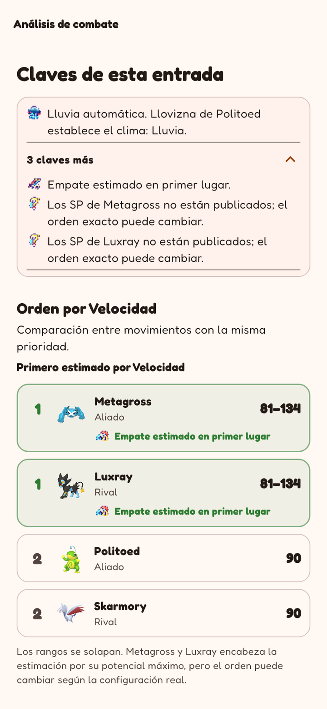</a>
<a href="../media/screenshots/1hitko-results.png">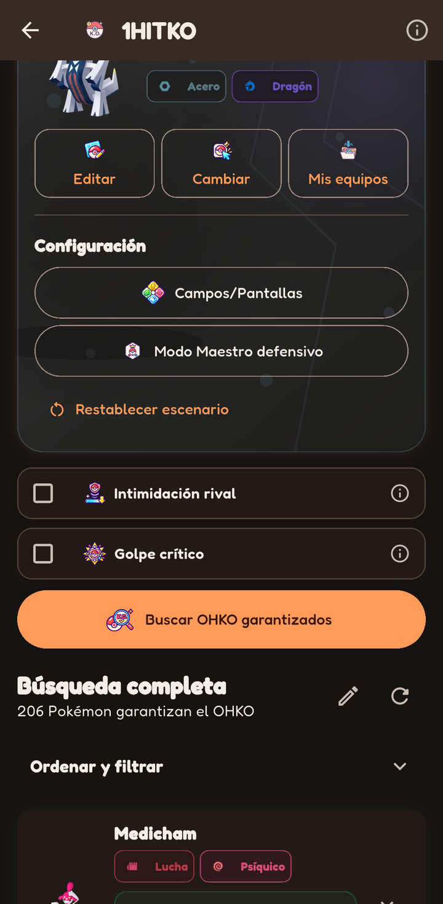</a>

- **Battle · HOST.** Actual entry-weather and speed analysis; unknown SP produce ranges and an estimated tie.
- **1HITKO · Android emulator.** Scrolled view after search completion: 206 candidates in this scenario and sorting/filter controls. This is not a universal count.

## Teams and provenance

<a href="../media/screenshots/team-coverage.png">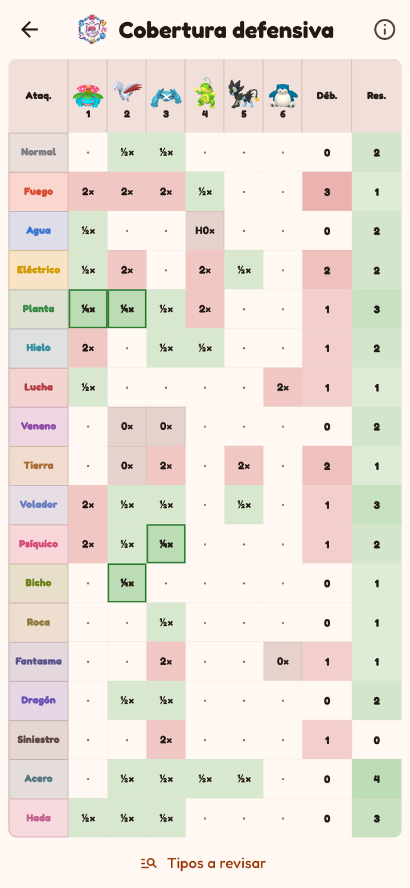</a>
<a href="../media/screenshots/tournaments.png">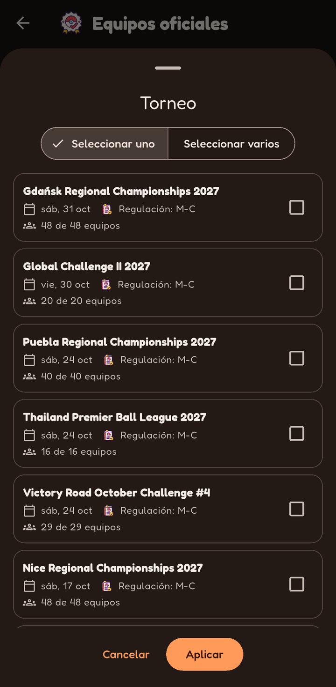</a>

- **Defensive coverage · HOST.** Matrix for a six-member example team: weaknesses, resistances and responses by type.
- **Tournaments · Android emulator.** Tournament selector with dates, historical regulation and multiple selection. The 2027 labels belong to official season event names.

## Configurations and reference

<a href="../media/screenshots/notes.png">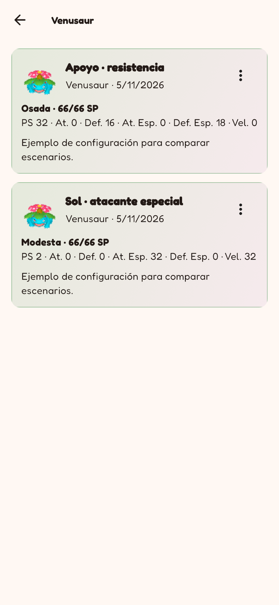</a>
<a href="../media/screenshots/library.png">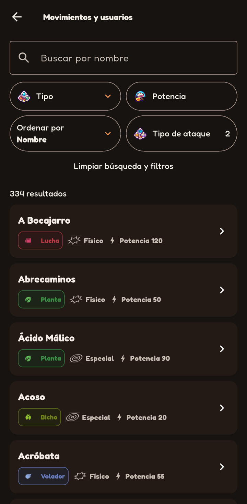</a>

- **Notes · HOST.** Two fictional Venusaur configurations in their group, with nature and SP spread. They are not competitive recommendations.
- **Library · Android emulator.** Moves and users with two applied categories: 334 results in this selection.

## Historical video demos

These seven silent MP4 clips were prepared in **September 2026**, before this refresh. They are retained byte for byte; their exact application builds are unverified. They demonstrate earlier flows, not new 1.0.1 features or current performance. Select a thumbnail or video link; nothing autoplays.

<a href="../media/demos/versus.mp4">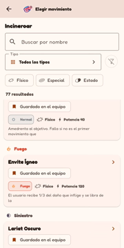</a>
<a href="../media/demos/ev-lab.mp4">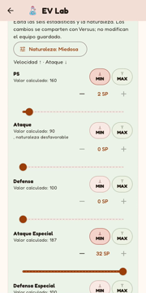</a>
<a href="../media/demos/1hitko.mp4">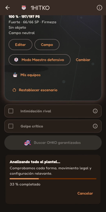</a>
<a href="../media/demos/team-builder.mp4">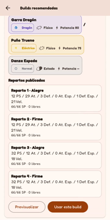</a>
<a href="../media/demos/entradas.mp4">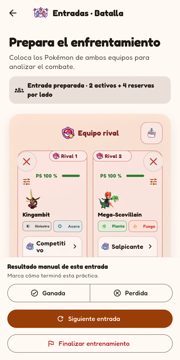</a>
<a href="../media/demos/history.mp4">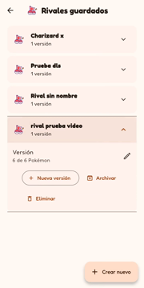</a>
<a href="../media/demos/languages.mp4">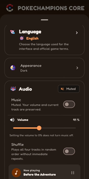</a>

| Demo | Duration | Context |
| --- | ---: | --- |
| [Versus](../media/demos/versus.mp4) | 12.6 s | 22/09/2026 · unverified build |
| [EV Lab](../media/demos/ev-lab.mp4) | 16.8 s | 22/09/2026 · unverified build |
| [1HITKO](../media/demos/1hitko.mp4) | 13 s | 17/09/2026 · unverified build |
| [Teams and builds](../media/demos/team-builder.mp4) | 21 s | 22/09/2026 · unverified build |
| [Lead Trainer](../media/demos/entradas.mp4) | 10 s | 22/09/2026 · unverified build |
| [History](../media/demos/history.mp4) | 9.2 s | 22/09/2026 · unverified build |
| [Languages](../media/demos/languages.mp4) | 13.9 s | 22/09/2026 · unverified build |

Lead Trainer outcomes and History results in demos are entered manually. Historical media may show older icons and controls. The current feature description is in [Features](FEATURES.en.md); the media manifest does not certify calculation accuracy.

[Validation](VALIDATION.en.md) · [Media inventory](../media/README.en.md) · [Ownership](../NOTICE.en.md)
