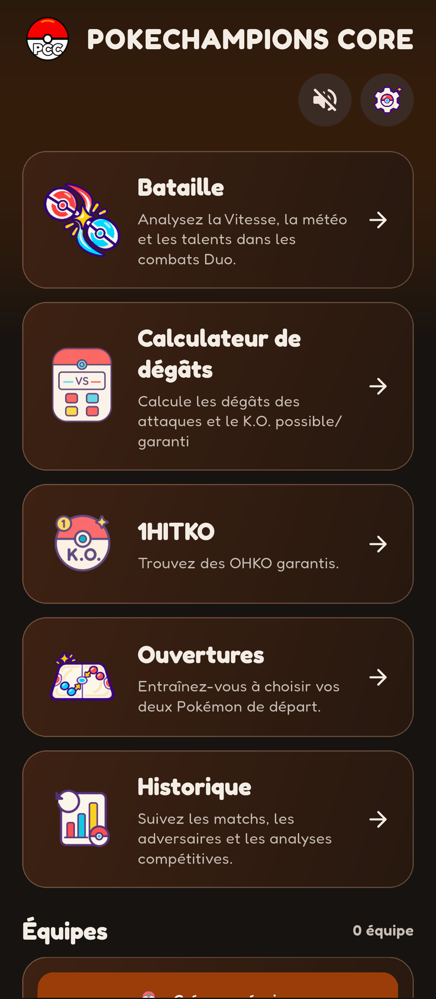
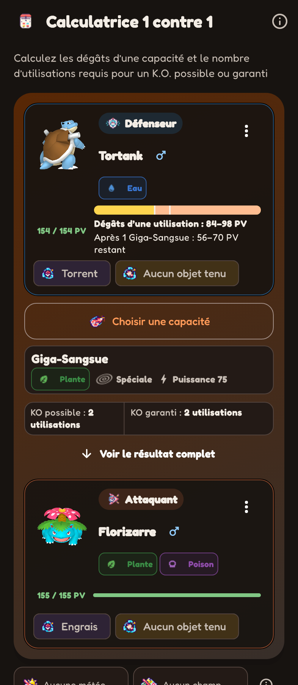
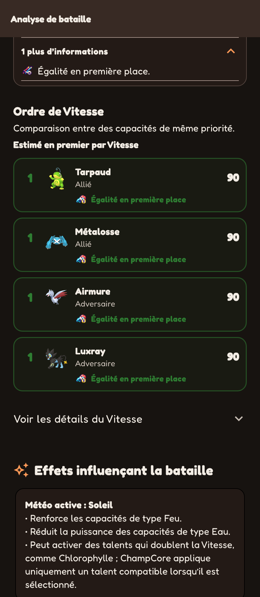
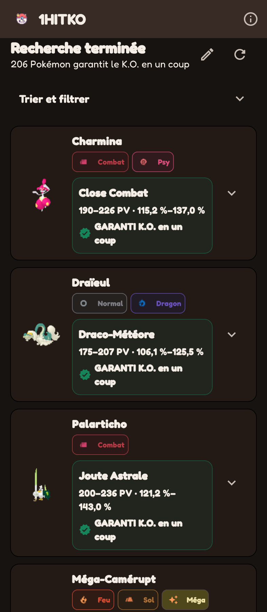
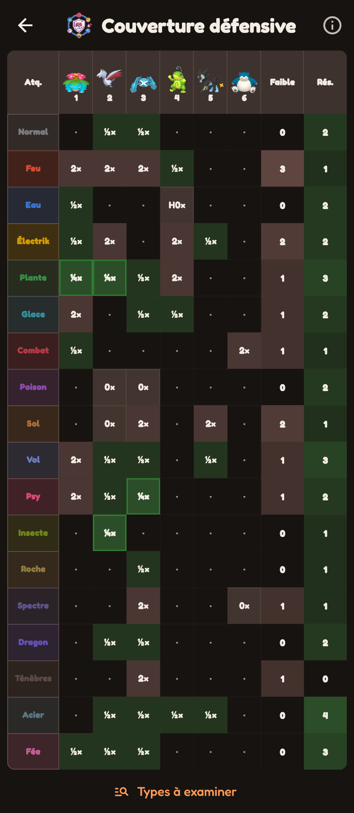
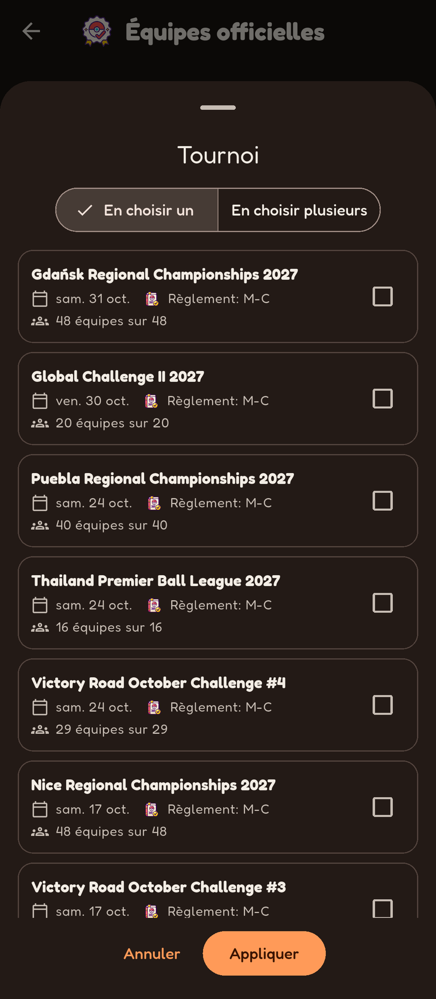
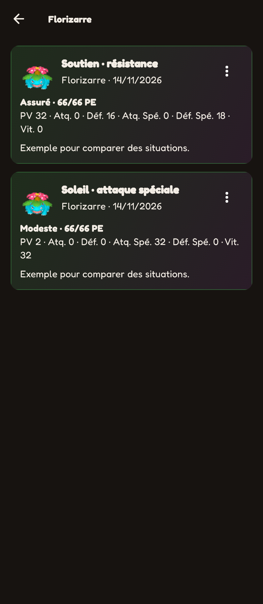
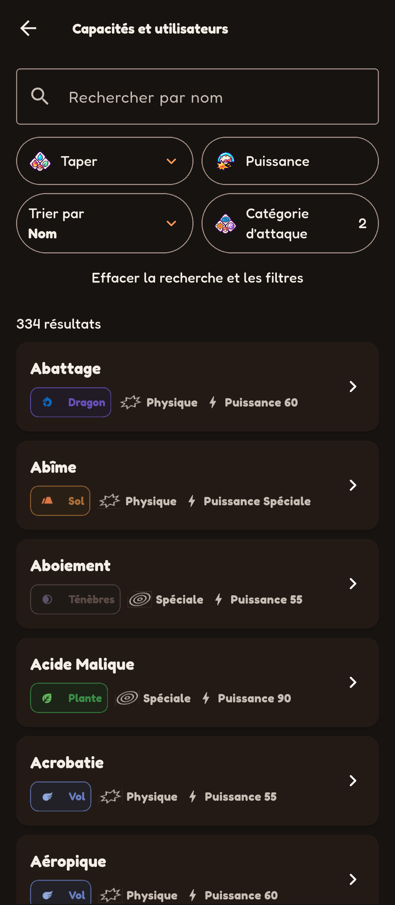

<a href="GALLERY.md">Español</a> · <a href="GALLERY.en.md">English</a> · <strong>Français</strong> · <a href="GALLERY.de.md">Deutsch</a> · <a href="GALLERY.it.md">Italiano</a> · <a href="GALLERY.pt.md">Português</a> · <a href="GALLERY.ja.md">日本語</a> · <a href="GALLERY.ko.md">한국어</a>

# PokeChampions Core · Galerie

[← Présentation](../README.fr.md) · [Fonctionnalités — anglais](FEATURES.en.md) · [Documentation — anglais](README.en.md)

Huit nouvelles captures du **14 novembre 2026**, avec l’interface en **français**, de la version **1.0.1**. **HOST** désigne de vrais widgets Flutter rendus sous Windows avec les catalogues et le moteur de cette version, et des données fictives isolées. **Émulateur Android** désigne la release 1.0.1/46 sur API 36 x86_64. Chaque légende et le manifeste précisent la provenance ; aucune image ne provient d’un téléphone physique.

Les mêmes Pokémon et configurations sont utilisés dans les huit langues. Seuls le retrait éventuel des barres système, la réduction proportionnelle et la compression WebP sont appliqués. Aucune interface générée ni traduction des pixels. [Cas et limites — anglais](SCENARIOS.en.md) · [Provenance — anglais](../media/README.en.md).

## Accueil et dégâts

- **Accueil · Android emulator.** Logo actuel et outils dans le thème sombre.
- **Versus · HOST.** Florizarre utilise Giga-Sangsue contre Tortank : 84–98 PV et K.O. possible et garanti en deux utilisations calculées.

## Scénarios et recherche

- **Combat · HOST.** Vitesse connue et soleil sélectionné manuellement dans une situation de combat Duo. Aucun tour n’est exécuté.
- **1HITKO · HOST.** Recherche terminée contre Pondralugon : 206 candidats dans ce scénario, avec filtres et tri. Ce n’est pas un total universel.

## Équipes et provenance

- **Couverture défensive · HOST.** Matrice défensive d’une équipe fictive de six membres : faiblesses, résistances et immunités.
- **Tournois · Android emulator.** Catalogue de tournois inclus, avec dates et règlements historiques. Les noms de saison peuvent comporter 2027.

## Configurations et références

- **Notes · HOST.** Deux configurations fictives de Florizarre, avec nature et SP. Ce ne sont pas des recommandations compétitives.
- **Bibliothèque · Android emulator.** Capacités et utilisateurs avec Physique et Spécial sélectionnés : 334 résultats dans ce catalogue.

## Démonstrations vidéo historiques

Ces sept vidéos MP4 sans son ont été préparées en **septembre 2026**. Leurs octets sont inchangés ; leur version exacte de l’application n’est pas vérifiée. Elles montrent des parcours antérieurs, pas les nouveautés de 1.0.1 ni les performances actuelles. Sélectionnez une miniature ou un lien ; aucune lecture automatique.

| Démo | Durée | Contexte |
| --- | ---: | --- |
| [Versus](../media/demos/versus.mp4) | 12.6 s | 22/09/2026 · version non vérifiée |
| [EV Lab](../media/demos/ev-lab.mp4) | 16.8 s | 22/09/2026 · version non vérifiée |
| [1HITKO](../media/demos/1hitko.mp4) | 13 s | 17/09/2026 · version non vérifiée |
| [Équipes et configurations](../media/demos/team-builder.mp4) | 21 s | 22/09/2026 · version non vérifiée |
| [Entraînement aux leads](../media/demos/entradas.mp4) | 10 s | 22/09/2026 · version non vérifiée |
| [Historique](../media/demos/history.mp4) | 9.2 s | 22/09/2026 · version non vérifiée |
| [Langues](../media/demos/languages.mp4) | 13.9 s | 22/09/2026 · version non vérifiée |

Les résultats d’entraînement aux leads et les parties de l’historique sont saisis manuellement. Les anciens médias peuvent montrer des icônes et contrôles antérieurs. Le manifeste multimédia ne certifie pas l’exactitude des calculs.

[Validation — anglais](VALIDATION.en.md) · [Inventaire des médias — anglais](../media/README.en.md) · [Droits — anglais](../NOTICE.en.md)
