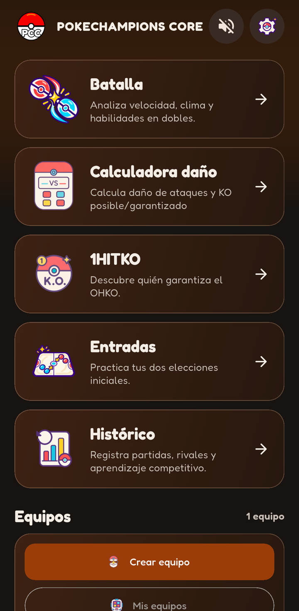

<a href="GALLERY.md">Español</a> · <a href="GALLERY.en.md">English</a> · <strong>Français</strong> · <a href="GALLERY.de.md">Deutsch</a> · <a href="GALLERY.it.md">Italiano</a> · <a href="GALLERY.pt.md">Português</a> · <a href="GALLERY.ja.md">日本語</a> · <a href="GALLERY.ko.md">한국어</a>

# PokeChampions Core · Galerie

[← Présentation](../README.fr.md) · [Fonctionnalités — anglais](FEATURES.en.md) · [Documentation — anglais](README.en.md)

Huit captures authentiques du **5 novembre 2026**, avec l’interface en espagnol. **Émulateur Android** désigne la version 1.0.1/46 sur API 36 x86_64. **HOST** désigne de vrais widgets Flutter rendus sous Windows à partir du code de cette version, avec des données fictives. Aucun téléphone physique n’a été utilisé pour cette série. Sélectionnez une image pour l’afficher en pleine résolution.

Seules les barres système ont été retirées des captures de l’émulateur. Les images HOST ne contiennent pas d’interface système Android. Toutes les images ont été réduites, jamais agrandies ; aucune interface ni aucun résultat n’a été reconstitué. [Provenance et traitement — anglais](../media/README.en.md).

## Accueil et dégâts

- **Accueil · Émulateur Android.** Logo actuel et raccourcis des outils dans le thème sombre.
- **Versus · Émulateur Android.** Damoclès : 45–54 PV de dégâts et nombre d’utilisations pour un K.O. possible ou garanti.

## Scénarios et recherche

- **Combat · HOST.** Analyse réelle de la météo à l’entrée et de la Vitesse ; les SP inconnus produisent des plages et une égalité estimée.
- **1HITKO · Émulateur Android.** Vue défilée après la recherche : 206 candidats pour ce scénario, avec tri et filtres. Ce nombre n’est pas universel.

## Équipes et provenance

- **Couverture défensive · HOST.** Matrice d’une équipe fictive de six membres : faiblesses, résistances et réponses par type.
- **Tournois · Émulateur Android.** Sélecteur de tournois avec dates, règlement historique et sélection multiple. Les mentions 2027 font partie des noms officiels des événements de la saison.

## Configurations et références

- **Notes · HOST.** Deux configurations fictives de Florizarre, regroupées avec leur nature et leurs SP. Ce ne sont pas des recommandations compétitives.
- **Bibliothèque · Émulateur Android.** Capacités et Pokémon pouvant les apprendre, avec deux catégories appliquées : 334 résultats pour cette sélection.

## Démonstrations vidéo historiques

Ces sept vidéos MP4 sans son ont été préparées en **septembre 2026**. Leurs octets sont inchangés ; leur version exacte de l’application n’est pas vérifiée. Elles montrent des parcours antérieurs, pas les nouveautés de 1.0.1 ni les performances actuelles. Sélectionnez une miniature ou un lien ; aucune lecture automatique.

| Démo | Durée | Contexte |
| --- | ---: | --- |
| [Versus](../media/demos/versus.mp4) | 12.6 s | 22/09/2026 · version non vérifiée |
| [EV Lab](../media/demos/ev-lab.mp4) | 16.8 s | 22/09/2026 · version non vérifiée |
| [1HITKO](../media/demos/1hitko.mp4) | 13 s | 17/09/2026 · version non vérifiée |
| [Équipes et configurations](../media/demos/team-builder.mp4) | 21 s | 22/09/2026 · version non vérifiée |
| [Entraînement aux leads](../media/demos/entradas.mp4) | 10 s | 22/09/2026 · version non vérifiée |
| [Historique](../media/demos/history.mp4) | 9.2 s | 22/09/2026 · version non vérifiée |
| [Langues](../media/demos/languages.mp4) | 13.9 s | 22/09/2026 · version non vérifiée |

Les résultats d’entraînement aux leads et les parties de l’historique sont saisis manuellement. Les anciens médias peuvent montrer des icônes et contrôles antérieurs. Le manifeste multimédia ne certifie pas l’exactitude des calculs.

[Validation — anglais](VALIDATION.en.md) · [Inventaire des médias — anglais](../media/README.en.md) · [Droits — anglais](../NOTICE.en.md)
