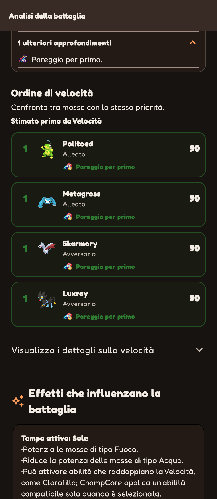
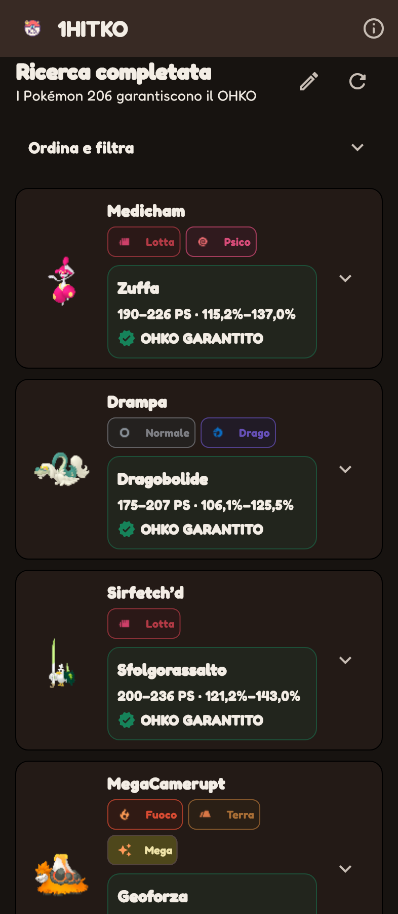
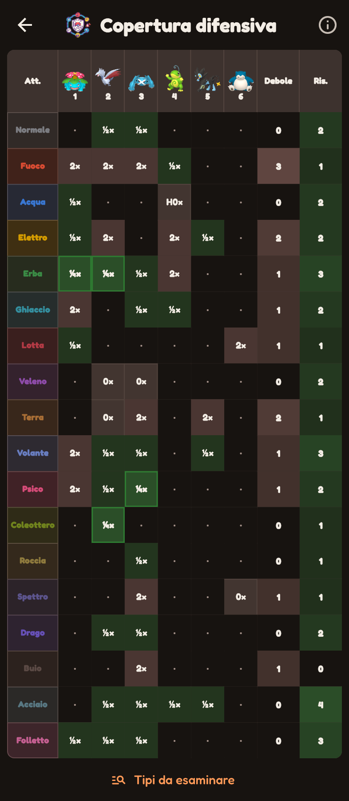
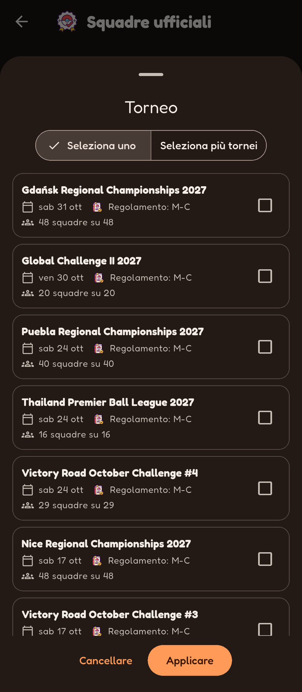
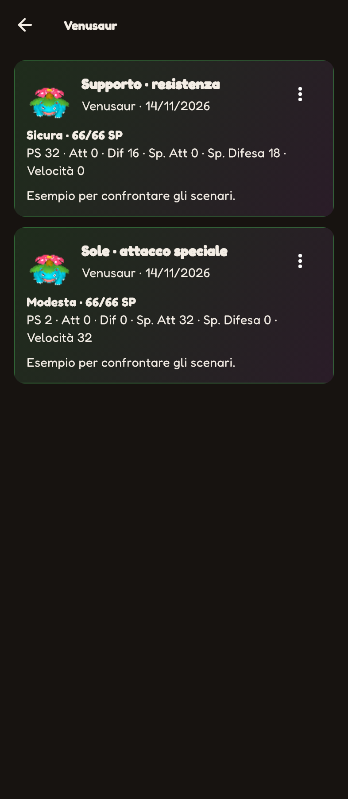

<a href="GALLERY.md">Español</a> · <a href="GALLERY.en.md">English</a> · <a href="GALLERY.fr.md">Français</a> · <a href="GALLERY.de.md">Deutsch</a> · <strong>Italiano</strong> · <a href="GALLERY.pt.md">Português</a> · <a href="GALLERY.ja.md">日本語</a> · <a href="GALLERY.ko.md">한국어</a>

# PokeChampions Core · Galleria

[← Presentazione](../README.it.md) · [Funzionalità — inglese](FEATURES.en.md) · [Documentazione — inglese](README.en.md)

Otto nuove immagini del **14 novembre 2026**, versione **1.0.1**, con interfaccia in **italiano**. **HOST** indica veri widget Flutter renderizzati su Windows con i cataloghi e il motore di questa versione e dati sintetici isolati. **Emulatore Android** indica la release 1.0.1/46 su API 36 x86_64. Ogni didascalia e il manifesto precisano l’origine; nessuna immagine proviene da un telefono fisico.

Gli stessi Pokémon e configurazioni sono usati nelle otto lingue. Sono applicati solo il ritaglio delle barre di sistema quando necessario, la riduzione proporzionale e la compressione WebP. Nessuna interfaccia generata o traduzione dei pixel. [Casi e limiti — inglese](SCENARIOS.en.md) · [Provenienza — inglese](../media/README.en.md).

## Schermata iniziale e danni

- **Schermata iniziale · Android emulator.** Logo attuale e strumenti nel tema scuro.
- **Versus · HOST.** Venusaur usa Gigassorbimento contro Blastoise: 84–98 PS di danno e KO possibile e garantito in due utilizzi calcolati.

## Scenari e ricerca

- **Lotta · HOST.** Velocità nota e sole selezionato manualmente in uno scenario di lotta in doppio. Non vengono eseguiti turni.
- **1HITKO · HOST.** Ricerca completata contro Archaludon: 206 candidati in questo scenario, con filtri e ordinamento. Non è un totale universale.

## Squadre e provenienza

- **Copertura difensiva · HOST.** Matrice difensiva di una squadra fittizia di sei membri: debolezze, resistenze e immunità.
- **Tornei · Android emulator.** Catalogo tornei incluso, con date e regolamenti storici. I nomi delle stagioni possono includere 2027.

## Configurazioni e consultazione

- **Note · HOST.** Due configurazioni fittizie di Venusaur, con natura e SP. Non sono consigli competitivi.
- **Biblioteca · Android emulator.** Mosse e utilizzatori con Fisico e Speciale selezionati: 334 risultati in questo catalogo.

## Demo video storiche

Questi sette video MP4 senza audio sono stati preparati a **settembre 2026**. I file sono conservati byte per byte; le build esatte dell’app non sono verificate. Mostrano flussi precedenti, non le novità di 1.0.1 o le prestazioni attuali. Seleziona una miniatura o un link; nessuna riproduzione automatica.

| Demo | Durata | Contesto |
| --- | ---: | --- |
| [Versus](../media/demos/versus.mp4) | 12.6 s | 22/09/2026 · build non verificata |
| [EV Lab](../media/demos/ev-lab.mp4) | 16.8 s | 22/09/2026 · build non verificata |
| [1HITKO](../media/demos/1hitko.mp4) | 13 s | 17/09/2026 · build non verificata |
| [Squadre e configurazioni](../media/demos/team-builder.mp4) | 21 s | 22/09/2026 · build non verificata |
| [Allenamento dei lead](../media/demos/entradas.mp4) | 10 s | 22/09/2026 · build non verificata |
| [Cronologia](../media/demos/history.mp4) | 9.2 s | 22/09/2026 · build non verificata |
| [Lingue](../media/demos/languages.mp4) | 13.9 s | 22/09/2026 · build non verificata |

I risultati dell’allenamento dei lead e della cronologia sono inseriti manualmente. I vecchi media possono mostrare icone e controlli precedenti. Il manifesto dei media non certifica la precisione dei calcoli.

[Validazione — inglese](VALIDATION.en.md) · [Inventario dei media — inglese](../media/README.en.md) · [Diritti — inglese](../NOTICE.en.md)
