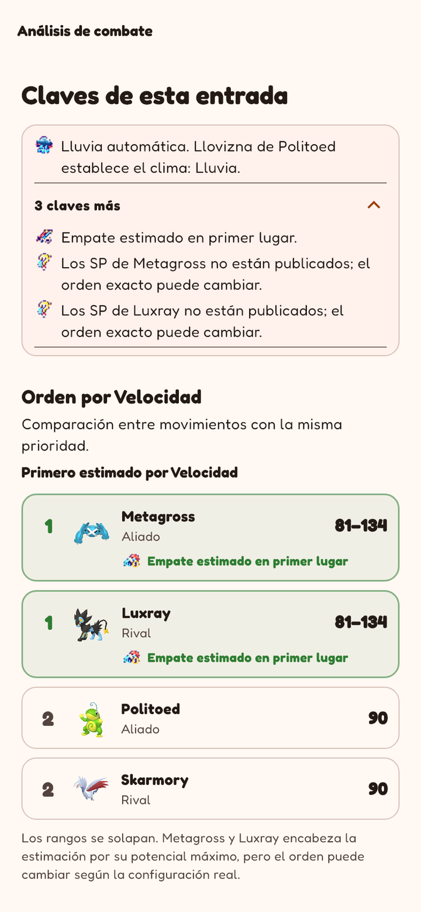
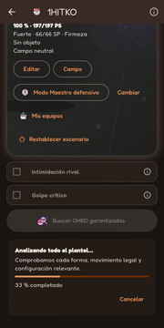
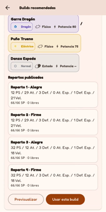

<a href="GALLERY.md">Español</a> · <a href="GALLERY.en.md">English</a> · <a href="GALLERY.fr.md">Français</a> · <a href="GALLERY.de.md">Deutsch</a> · <strong>Italiano</strong> · <a href="GALLERY.pt.md">Português</a> · <a href="GALLERY.ja.md">日本語</a> · <a href="GALLERY.ko.md">한국어</a>

# PokeChampions Core · Galleria

[← Presentazione](../README.it.md) · [Funzionalità — inglese](FEATURES.en.md) · [Documentazione — inglese](README.en.md)

Otto screenshot autentici del **5 novembre 2026**, con interfaccia in spagnolo. **Emulatore Android** indica la versione 1.0.1/46 su API 36 x86_64; **HOST** indica veri widget Flutter renderizzati su Windows dal codice di quella versione, con dati fittizi. Per questa serie non è stato usato un telefono fisico. Seleziona un’immagine per aprirla a piena risoluzione.

Dalle immagini dell’emulatore sono state ritagliate soltanto le barre di sistema. Le immagini HOST non contengono elementi di sistema Android. Tutte le immagini sono state ridotte, mai ingrandite; nessuna interfaccia o risultato è stato ricostruito. [Provenienza ed elaborazione — inglese](../media/README.en.md).

## Schermata iniziale e danni

- **Schermata iniziale · Emulatore Android.** Logo attuale e scorciatoie agli strumenti nel tema scuro.
- **Versus · Emulatore Android.** Sdoppiatore: 45–54 PS di danno, con utilizzi necessari per un K.O. possibile o garantito.

## Scenari e ricerca

- **Lotta · HOST.** Analisi reale del meteo all’ingresso e della Velocità; gli SP sconosciuti producono intervalli e una parità stimata.
- **1HITKO · Emulatore Android.** Vista scorsa dopo la ricerca: 206 candidati in questo scenario, con ordinamento e filtri. Non è un numero universale.

## Squadre e provenienza

- **Copertura difensiva · HOST.** Matrice di una squadra di esempio di sei membri: debolezze, resistenze e risposte per tipo.
- **Tornei · Emulatore Android.** Selettore dei tornei con date, regolamento storico e selezione multipla. Le diciture 2027 appartengono ai nomi ufficiali degli eventi della stagione.

## Configurazioni e consultazione

- **Note · HOST.** Due configurazioni fittizie di Venusaur nel loro gruppo, con natura e SP. Non sono consigli competitivi.
- **Biblioteca · Emulatore Android.** Mosse e Pokémon che le apprendono, con due categorie applicate: 334 risultati per questa selezione.

## Demo video storiche

Questi sette video MP4 senza audio sono stati preparati a **settembre 2026**. I file sono conservati byte per byte; le build esatte dell’app non sono verificate. Mostrano flussi precedenti, non le novità di 1.0.1 o le prestazioni attuali. Seleziona una miniatura o un link; nessuna riproduzione automatica.

| Demo | Durata | Contesto |
| --- | ---: | --- |
| [Versus](../media/demos/versus.mp4) | 12.6 s | 22/09/2026 · build non verificata |
| [EV Lab](../media/demos/ev-lab.mp4) | 16.8 s | 22/09/2026 · build non verificata |
| [1HITKO](../media/demos/1hitko.mp4) | 13 s | 17/09/2026 · build non verificata |
| [Squadre e configurazioni](../media/demos/team-builder.mp4) | 21 s | 22/09/2026 · build non verificata |
| [Allenamento dei lead](../media/demos/entradas.mp4) | 10 s | 22/09/2026 · build non verificata |
| [Cronologia](../media/demos/history.mp4) | 9.2 s | 22/09/2026 · build non verificata |
| [Lingue](../media/demos/languages.mp4) | 13.9 s | 22/09/2026 · build non verificata |

I risultati dell’allenamento dei lead e della cronologia sono inseriti manualmente. I vecchi media possono mostrare icone e controlli precedenti. Il manifesto dei media non certifica la precisione dei calcoli.

[Validazione — inglese](VALIDATION.en.md) · [Inventario dei media — inglese](../media/README.en.md) · [Diritti — inglese](../NOTICE.en.md)
