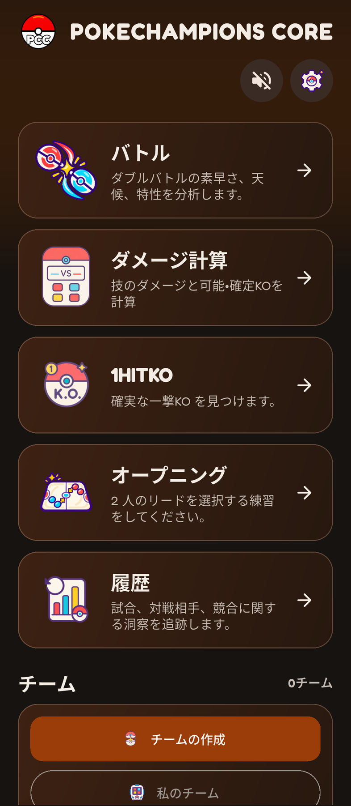
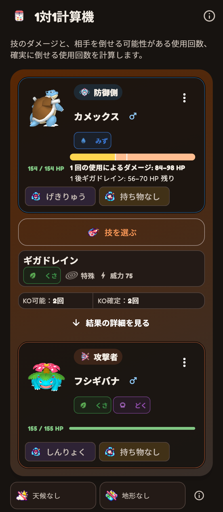
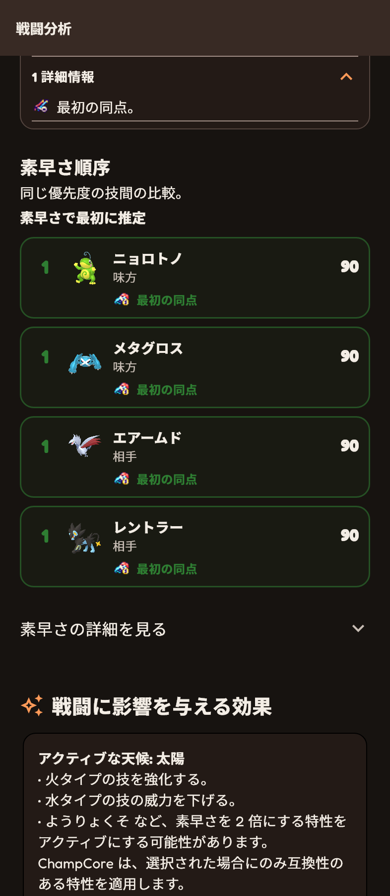
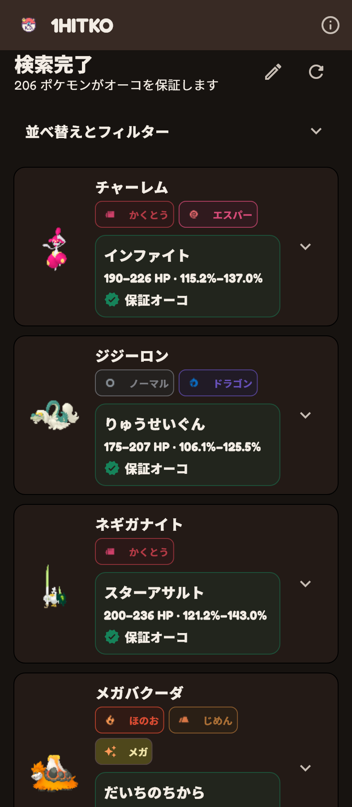
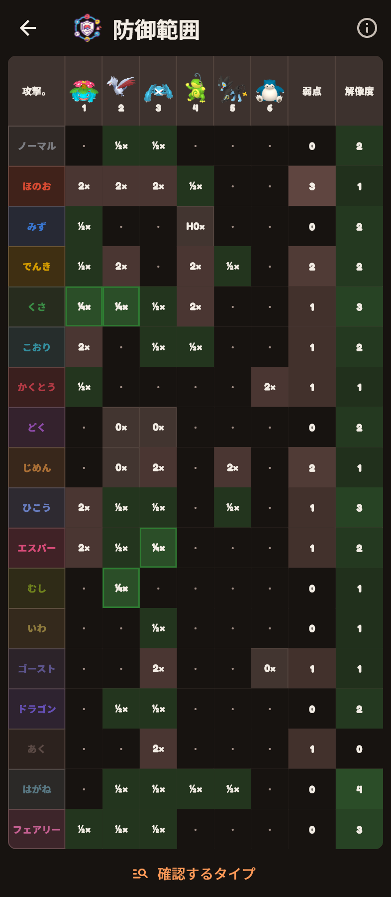
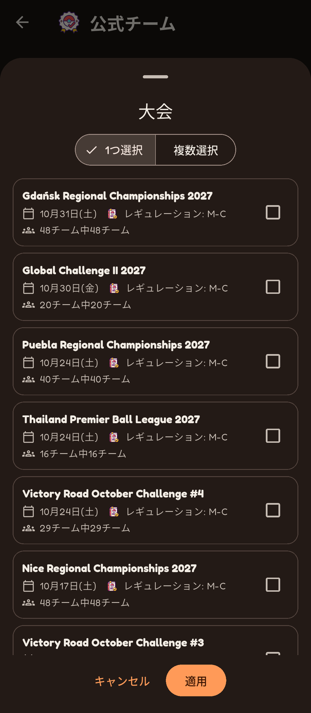
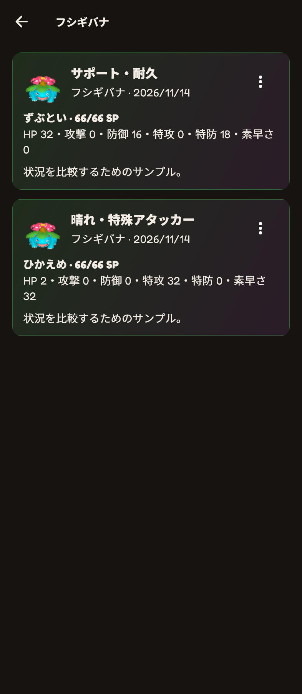
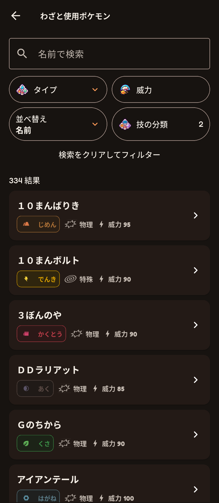
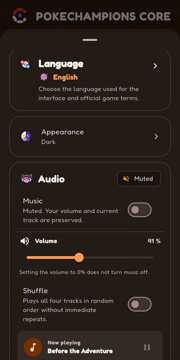

<a href="GALLERY.md">Español</a> · <a href="GALLERY.en.md">English</a> · <a href="GALLERY.fr.md">Français</a> · <a href="GALLERY.de.md">Deutsch</a> · <a href="GALLERY.it.md">Italiano</a> · <a href="GALLERY.pt.md">Português</a> · <strong>日本語</strong> · <a href="GALLERY.ko.md">한국어</a>

# PokeChampions Core · ギャラリー

[← 紹介ページ](../README.ja.md) · [機能 — 英語](FEATURES.en.md) · [ドキュメント — 英語](README.en.md)

バージョン**1.0.1**の**日本語**画面を、**2026年11月14日**に新しく撮影した8枚の画像です。**HOST**は、このバージョンのカタログと計算処理、独立した架空のデータを使用し、Windows上で描画した実際のFlutterウィジェットを示します。**Android エミュレーター**はAPI 36 x86_64上のrelease 1.0.1/46を示します。各説明とマニフェストに出典を記載しています。実機スマートフォンの画像ではありません。

8言語で同じポケモンと設定を使用しています。加工は必要な場合のシステムバーの切り取り、縦横比を保った縮小、WebP圧縮のみです。生成した画面や画像内の文字の置き換えはありません。[テストケースと制限 — 英語](SCENARIOS.en.md) · [出典 — 英語](../media/README.en.md)。

## ホームとダメージ

- **ホーム · Android emulator.** ダークテーマの現在のロゴとツール一覧。
- **Versus · HOST.** フシギバナのギガドレインをカメックスに使用：84〜98 HPのダメージ。計算上は2回の使用でKO可能・確定となります。

## 状況分析と検索

- **バトル · HOST.** 素早さが既知で、晴れを手動選択したダブルバトルの状況。ターンを実行する機能ではありません。
- **1HITKO · HOST.** ブリジュラスに対する検索完了画面。この条件では206件の候補があり、絞り込みと並べ替えを利用できます。常に同じ件数になるわけではありません。

## チームとデータの出典

- **防御面のタイプ相性 · HOST.** 架空の6匹のチームの防御面の表。弱点、耐性、無効を表示します。
- **大会 · Android emulator.** 収録された大会カタログの日付と当時のレギュレーション。シーズン名に2027が含まれる場合があります。

## 構成と資料

- **メモ · HOST.** 性格とSP配分を持つフシギバナの架空の構成2件。対戦向けの推奨構成ではありません。
- **ライブラリー · Android emulator.** 技と習得ポケモンの検索。物理と特殊を選択したこのカタログでは334件を表示します。

## 過去の動画デモ

7本の無音MP4は **2026年9月**に用意したものです。ファイルの内容は変更していませんが、正確なアプリのビルドは未確認です。過去の操作を示す動画で、1.0.1の新機能や現在の性能を示すものではありません。サムネイルかリンクを選択して再生します。自動再生はありません。

| デモ | 長さ | 撮影情報 |
| --- | ---: | --- |
| [Versus](../media/demos/versus.mp4) | 12.6 s | 22/09/2026 · ビルド未確認 |
| [EV Lab](../media/demos/ev-lab.mp4) | 16.8 s | 22/09/2026 · ビルド未確認 |
| [1HITKO](../media/demos/1hitko.mp4) | 13 s | 17/09/2026 · ビルド未確認 |
| [チームと構成](../media/demos/team-builder.mp4) | 21 s | 22/09/2026 · ビルド未確認 |
| [先発練習](../media/demos/entradas.mp4) | 10 s | 22/09/2026 · ビルド未確認 |
| [対戦履歴](../media/demos/history.mp4) | 9.2 s | 22/09/2026 · ビルド未確認 |
| [言語](../media/demos/languages.mp4) | 13.9 s | 22/09/2026 · ビルド未確認 |

先発練習と対戦履歴の結果は手動入力です。過去の動画には古いアイコンや操作部品が含まれる場合があります。メディアのマニフェストは計算の正確性を保証するものではありません。

[検証 — 英語](VALIDATION.en.md) · [メディア一覧 — 英語](../media/README.en.md) · [権利表記 — 英語](../NOTICE.en.md)
