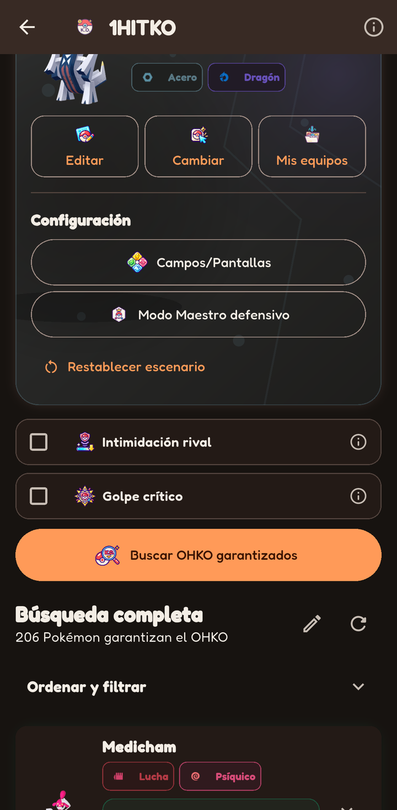
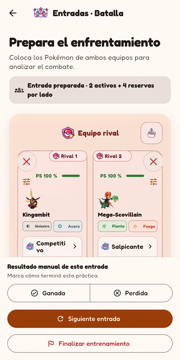

<a href="GALLERY.md">Español</a> · <a href="GALLERY.en.md">English</a> · <a href="GALLERY.fr.md">Français</a> · <a href="GALLERY.de.md">Deutsch</a> · <a href="GALLERY.it.md">Italiano</a> · <a href="GALLERY.pt.md">Português</a> · <strong>日本語</strong> · <a href="GALLERY.ko.md">한국어</a>

# PokeChampions Core · ギャラリー

[← 紹介ページ](../README.ja.md) · [機能 — 英語](FEATURES.en.md) · [ドキュメント — 英語](README.en.md)

**2026年11月5日**に作成した8枚の実際のスクリーンショットです。画面はスペイン語です。**Android エミュレーター**は API 36 x86_64 上のバージョン1.0.1/46を示します。**HOST**は同バージョンのソースから、架空のデータを使い Windows 上で描画した実際の Flutter ウィジェットを示します。この画像更新では実機のスマートフォンを使用していません。画像を選択すると元の解像度で開けます。

エミュレーター画像ではシステムバーのみを切り取っています。HOST画像には Android のシステム表示は含まれません。すべて縮小のみで、拡大はしていません。画面や結果を作り直した画像ではありません。 [出典と加工方法 — 英語](../media/README.en.md).

## ホームとダメージ

- **ホーム · Android エミュレーター.** ダークテーマで表示した現在のロゴと各ツールへのショートカット。
- **Versus · Android エミュレーター.** すてみタックル：45〜54 HPのダメージと、KOの可能性がある回数・確定する回数。

## 状況分析と検索

- **バトル · HOST.** 場に出た際の天候と素早さの実際の分析。SPが不明な場合は範囲と推定の同速を表示します。
- **1HITKO · Android エミュレーター.** 検索完了後にスクロールした画面。この条件では206件の候補があり、並べ替えと絞り込みを利用できます。常に206件になるわけではありません。

## チームとデータの出典

- **防御面のタイプ相性 · HOST.** 6匹のサンプルチームの表。弱点、耐性、タイプ別の対応を示します。
- **大会 · Android エミュレーター.** 日付、当時のレギュレーション、複数選択に対応した大会選択画面。2027の表記はシーズンの公式大会名に含まれるものです。

## 構成と資料

- **メモ · HOST.** フシギバナの架空の構成2件を、性格・SP配分とともにグループ表示。対戦向けの推奨構成ではありません。
- **ライブラリー · Android エミュレーター.** 技と習得ポケモンの検索。2種類の分類を適用したこの選択では334件を表示しています。

## 過去の動画デモ

7本の無音MP4は **2026年9月**に用意したものです。ファイルの内容は変更していませんが、正確なアプリのビルドは未確認です。過去の操作を示す動画で、1.0.1の新機能や現在の性能を示すものではありません。サムネイルかリンクを選択して再生します。自動再生はありません。

| デモ | 長さ | 撮影情報 |
| --- | ---: | --- |
| [Versus](../media/demos/versus.mp4) | 12.6 s | 22/09/2026 · ビルド未確認 |
| [EV Lab](../media/demos/ev-lab.mp4) | 16.8 s | 22/09/2026 · ビルド未確認 |
| [1HITKO](../media/demos/1hitko.mp4) | 13 s | 17/09/2026 · ビルド未確認 |
| [チームと構成](../media/demos/team-builder.mp4) | 21 s | 22/09/2026 · ビルド未確認 |
| [先発練習](../media/demos/entradas.mp4) | 10 s | 22/09/2026 · ビルド未確認 |
| [対戦履歴](../media/demos/history.mp4) | 9.2 s | 22/09/2026 · ビルド未確認 |
| [言語](../media/demos/languages.mp4) | 13.9 s | 22/09/2026 · ビルド未確認 |

先発練習と対戦履歴の結果は手動入力です。過去の動画には古いアイコンや操作部品が含まれる場合があります。メディアのマニフェストは計算の正確性を保証するものではありません。

[検証 — 英語](VALIDATION.en.md) · [メディア一覧 — 英語](../media/README.en.md) · [権利表記 — 英語](../NOTICE.en.md)
