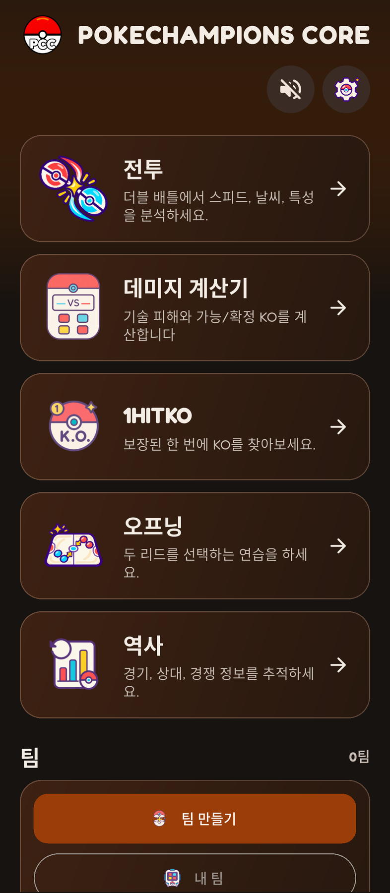
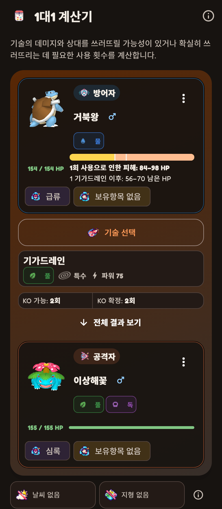
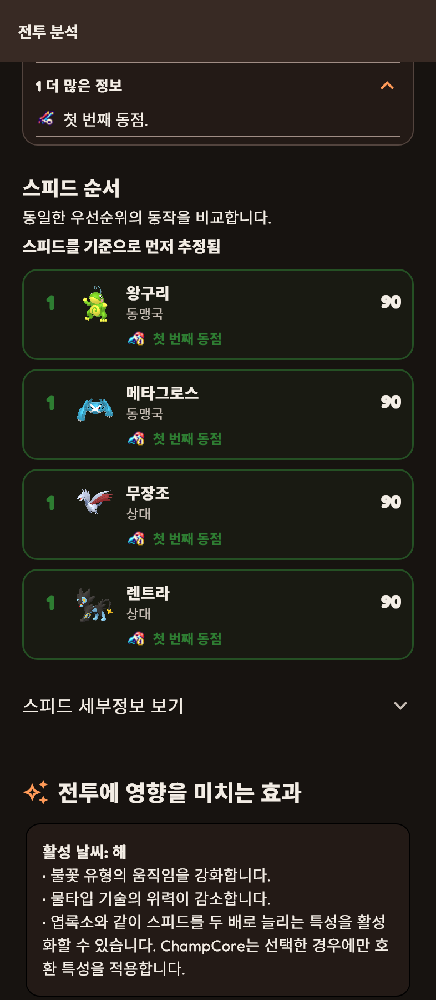
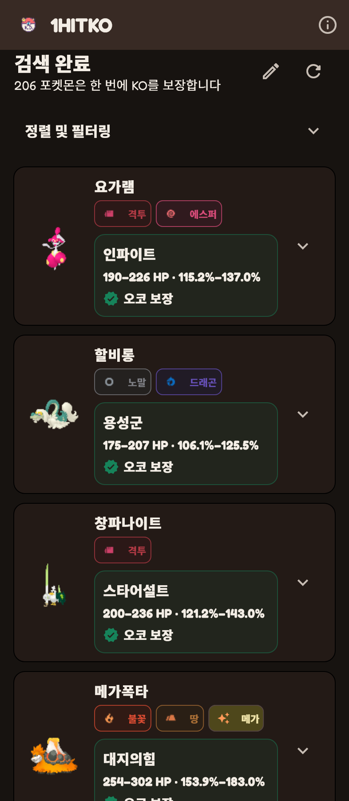
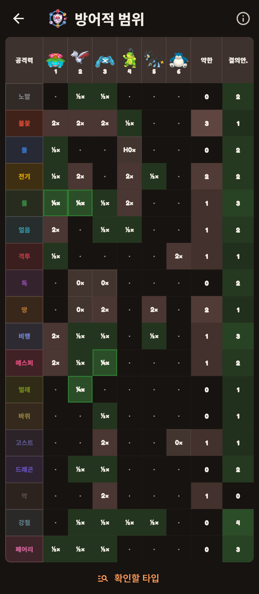
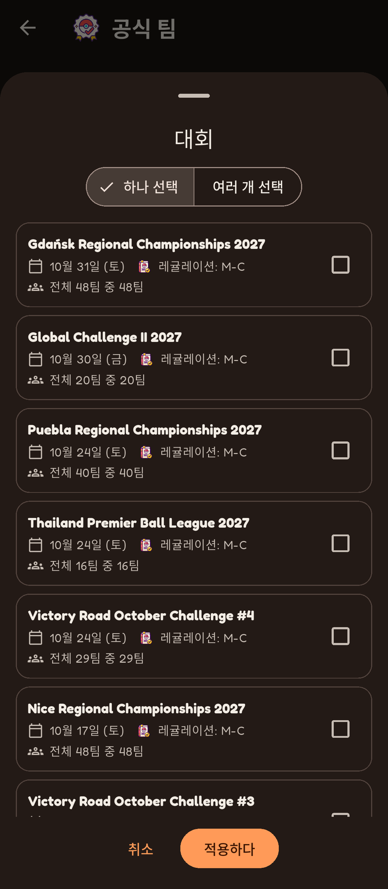
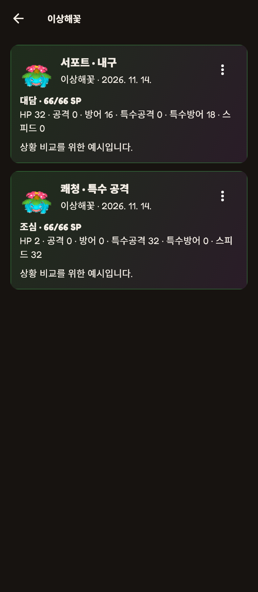
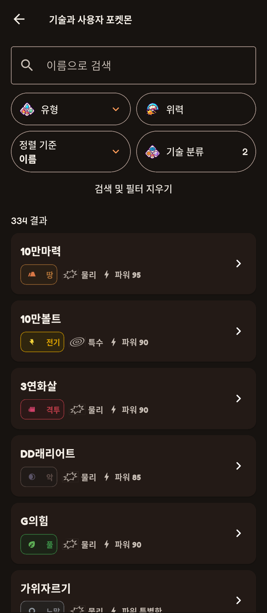

<a href="GALLERY.md">Español</a> · <a href="GALLERY.en.md">English</a> · <a href="GALLERY.fr.md">Français</a> · <a href="GALLERY.de.md">Deutsch</a> · <a href="GALLERY.it.md">Italiano</a> · <a href="GALLERY.pt.md">Português</a> · <a href="GALLERY.ja.md">日本語</a> · <strong>한국어</strong>

# PokeChampions Core · 갤러리

[← 소개](../README.ko.md) · [기능 — 영어](FEATURES.en.md) · [문서 — 영어](README.en.md)

버전 **1.0.1**의 **한국어** 화면을 **2026년 11월 14일**에 새로 촬영한 이미지 8장입니다. **HOST**는 해당 버전의 카탈로그와 계산 엔진, 분리된 가상 데이터를 사용해 Windows에서 렌더링한 실제 Flutter 위젯입니다. **Android 에뮬레이터**는 API 36 x86_64의 release 1.0.1/46을 뜻합니다. 각 설명과 매니페스트에 출처를 표시합니다. 실제 스마트폰에서 촬영한 이미지는 아닙니다.

8개 언어에서 같은 포켓몬과 설정을 사용합니다. 필요한 경우 시스템 표시줄 자르기, 비율을 유지한 축소, WebP 압축만 적용합니다. 생성된 인터페이스나 이미지 속 텍스트 번역은 없습니다. [테스트 사례 및 한계 — 영어](SCENARIOS.en.md) · [출처 — 영어](../media/README.en.md).

## 홈과 데미지

- **홈 · Android emulator.** 다크 테마의 현재 로고와 도구 목록.
- **Versus · HOST.** 이상해꽃이 거북왕에게 기가드레인을 사용합니다. 데미지 84~98 HP, 계산상 2회 사용으로 KO 가능·확정입니다.

## 상황 분석과 검색

- **배틀 · HOST.** 스피드가 알려져 있고 쾌청을 수동 선택한 더블 배틀 상황입니다. 턴을 실행하지 않습니다.
- **1HITKO · HOST.** 브리두라스에 대한 검색 완료 화면입니다. 이 상황에서 후보 206개와 필터·정렬을 표시하며, 항상 같은 수가 나오는 것은 아닙니다.

## 팀과 데이터 출처

- **방어 타입 상성 · HOST.** 가상의 포켓몬 6마리 팀의 방어 상성표입니다. 약점, 내성, 무효를 표시합니다.
- **대회 · Android emulator.** 포함된 대회 카탈로그의 날짜와 당시 레귤레이션입니다. 시즌 이름에 2027이 포함될 수 있습니다.

## 세팅과 자료

- **메모 · HOST.** 성격과 SP를 포함한 이상해꽃의 가상 설정 2개입니다. 대전용 추천 설정은 아닙니다.
- **라이브러리 · Android emulator.** 기술과 사용자 검색에서 물리와 특수를 선택한 결과입니다. 이 카탈로그에서는 334개를 표시합니다.

## 과거 영상 데모

무음 MP4 7개는 **2026년 9월**에 준비했습니다. 파일 내용은 그대로 보존했지만 정확한 앱 빌드는 확인되지 않았습니다. 이전 사용 흐름을 보여 주며, 1.0.1의 새 기능이나 현재 성능을 증명하지 않습니다. 썸네일이나 링크를 선택해 재생하세요. 자동 재생은 없습니다.

| 데모 | 길이 | 정보 |
| --- | ---: | --- |
| [Versus](../media/demos/versus.mp4) | 12.6 s | 22/09/2026 · 빌드 미확인 |
| [EV Lab](../media/demos/ev-lab.mp4) | 16.8 s | 22/09/2026 · 빌드 미확인 |
| [1HITKO](../media/demos/1hitko.mp4) | 13 s | 17/09/2026 · 빌드 미확인 |
| [팀과 세팅](../media/demos/team-builder.mp4) | 21 s | 22/09/2026 · 빌드 미확인 |
| [선봉 연습](../media/demos/entradas.mp4) | 10 s | 22/09/2026 · 빌드 미확인 |
| [대전 기록](../media/demos/history.mp4) | 9.2 s | 22/09/2026 · 빌드 미확인 |
| [언어](../media/demos/languages.mp4) | 13.9 s | 22/09/2026 · 빌드 미확인 |

선봉 연습과 대전 기록의 결과는 수동으로 입력합니다. 과거 영상에는 이전 아이콘이나 조작 요소가 보일 수 있습니다. 미디어 매니페스트는 계산 정확성을 보증하지 않습니다.

[검증 — 영어](VALIDATION.en.md) · [미디어 목록 — 영어](../media/README.en.md) · [권리 — 영어](../NOTICE.en.md)
