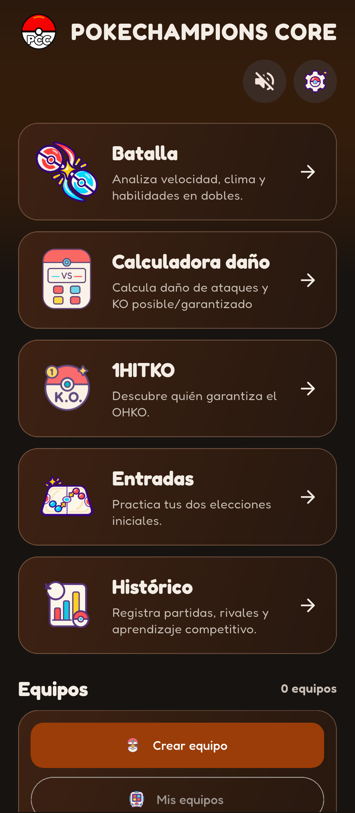
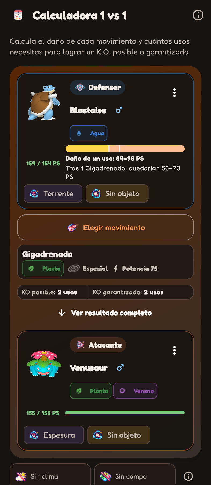
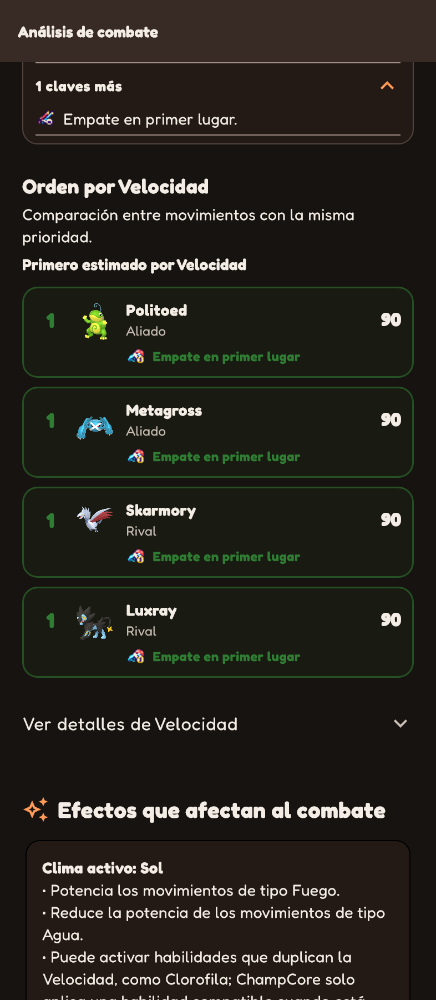
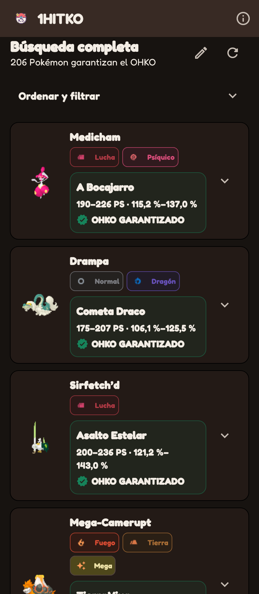
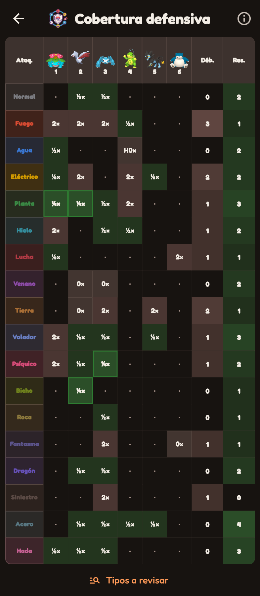
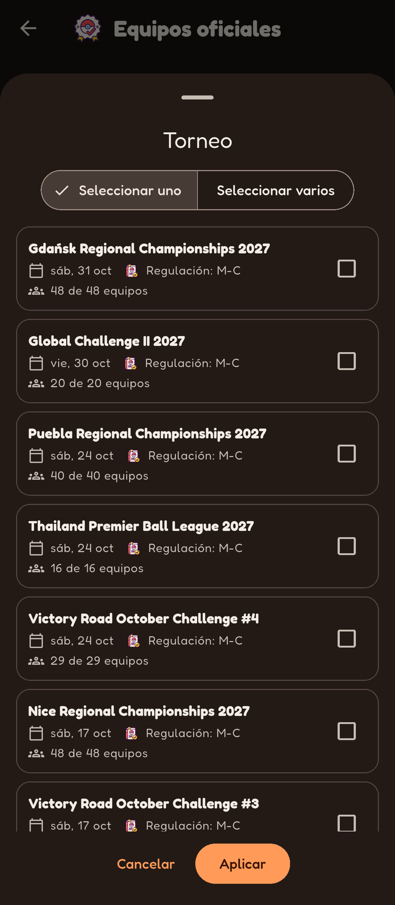
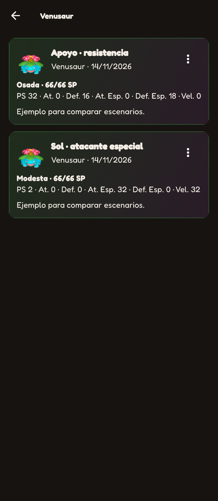
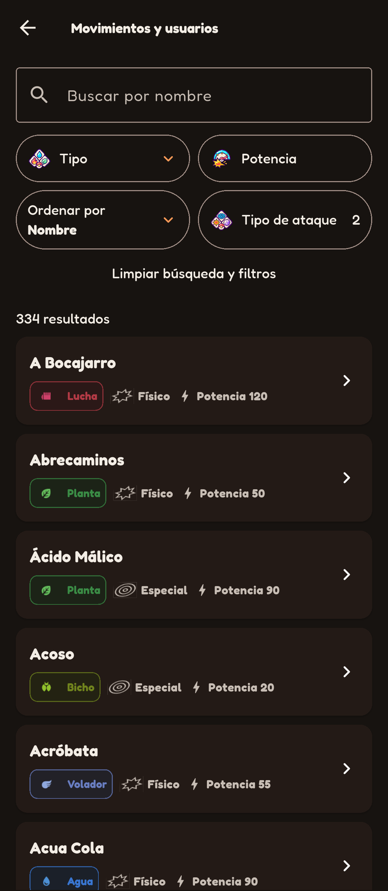
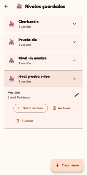

<strong>Español</strong> · <a href="GALLERY.en.md">English</a> · <a href="GALLERY.fr.md">Français</a> · <a href="GALLERY.de.md">Deutsch</a> · <a href="GALLERY.it.md">Italiano</a> · <a href="GALLERY.pt.md">Português</a> · <a href="GALLERY.ja.md">日本語</a> · <a href="GALLERY.ko.md">한국어</a>

# PokeChampions Core · Galería

[← Portada](../README.md) · [Funciones](FEATURES.md) · [Documentación](README.md)

Ocho capturas nuevas del **14 de noviembre de 2026**, con interfaz **española**, de **1.0.1**. **HOST** identifica widgets Flutter reales renderizados en Windows con los catálogos y el motor de esa entrega y datos sintéticos aislados. **Emulador Android** identifica la release 1.0.1/46 en API 36 x86_64. Cada pie y el manifiesto precisan su procedencia; ninguna imagen es una captura de móvil físico.

Los escenarios conservan los mismos Pokémon y configuraciones en los ocho idiomas. Solo se aplica recorte de barras del sistema cuando procede, reducción proporcional y compresión WebP. No hay interfaces generadas ni traducción de píxeles. [Casos y límites](SCENARIOS.md) · [Procedencia](../media/README.md).

## Inicio y daño

- **Inicio · Android emulator.** Logo actual y herramientas en tema oscuro.
- **Versus · HOST.** Venusaur usa Gigadrenado contra Blastoise: 84–98 PS y KO posible y garantizado en dos usos calculados.

## Escenarios y búsqueda

- **Batalla · HOST.** Velocidad conocida y sol seleccionado manualmente en un escenario de dobles. No ejecuta turnos.
- **1HITKO · HOST.** Búsqueda completada contra Archaludon: 206 candidatos en este escenario, con filtros y ordenación. No es un total universal.

## Equipos y procedencia

- **Cobertura defensiva · HOST.** Matriz defensiva de un equipo sintético de seis integrantes: debilidades, resistencias e inmunidades.
- **Torneos · Android emulator.** Torneos del catálogo empaquetado, con fecha y regulación histórica. Los nombres de temporada pueden incluir 2027.

## Configuraciones y consulta

- **Notas · HOST.** Dos configuraciones sintéticas de Venusaur, con naturaleza y SP. No son recomendaciones competitivas.
- **Biblioteca · Android emulator.** Movimientos y usuarios con Físico y Especial seleccionados: 334 resultados en este catálogo.

## Demostraciones históricas en vídeo

Estos siete MP4 sin audio se prepararon en **septiembre de 2026**, antes de esta revisión. Se conservan byte a byte y no se ha verificado la compilación exacta de la app. Muestran recorridos anteriores, no acreditan novedades de 1.0.1 ni su rendimiento actual. Pulsa una miniatura o enlace de vídeo; no hay reproducción automática.

| Demo | Duración | Contexto |
| --- | ---: | --- |
| [Versus](../media/demos/versus.mp4) | 12,6 s | 22/09/2026 · compilación no verificada |
| [EV Lab](../media/demos/ev-lab.mp4) | 16,8 s | 22/09/2026 · compilación no verificada |
| [1HITKO](../media/demos/1hitko.mp4) | 13 s | 17/09/2026 · compilación no verificada |
| [Equipos y builds](../media/demos/team-builder.mp4) | 21 s | 22/09/2026 · compilación no verificada |
| [Entradas](../media/demos/entradas.mp4) | 10 s | 22/09/2026 · compilación no verificada |
| [Histórico](../media/demos/history.mp4) | 9,2 s | 22/09/2026 · compilación no verificada |
| [Idiomas](../media/demos/languages.mp4) | 13,9 s | 22/09/2026 · compilación no verificada |

Los resultados de Entradas e Histórico de las demos se introducen manualmente. El material histórico puede mostrar iconos y controles antiguos. Las funciones actuales se describen en [Funciones](FEATURES.md); el manifiesto multimedia no certifica la exactitud de cálculo.

[Validación](VALIDATION.md) · [Inventario multimedia](../media/README.md) · [Derechos](../NOTICE.md)
