
<strong>Español</strong> · <a href="GALLERY.en.md">English</a>

# PokeChampions Core · Galería

[← Portada](../README.md) · [Funciones](FEATURES.md) · [Documentación](README.md)

Ocho capturas auténticas del **5 de noviembre de 2026**, con interfaz española. **Emulador Android** identifica la release 1.0.1/46 en API 36 x86_64; **HOST** identifica widgets Flutter reales renderizados en Windows desde la copia de código de esa entrega, con datos ficticios. No se utilizó un móvil físico para esta actualización. Pulsa una imagen para verla a resolución completa.

Solo se recortaron las barras del sistema en las imágenes del emulador. Las HOST no contienen barras de Android. Se redujeron, nunca se ampliaron; no se reconstruyó ninguna interfaz ni resultado. [Procedencia y tratamiento](../media/README.md).

## Inicio y daño

<a href="../media/screenshots/home.png">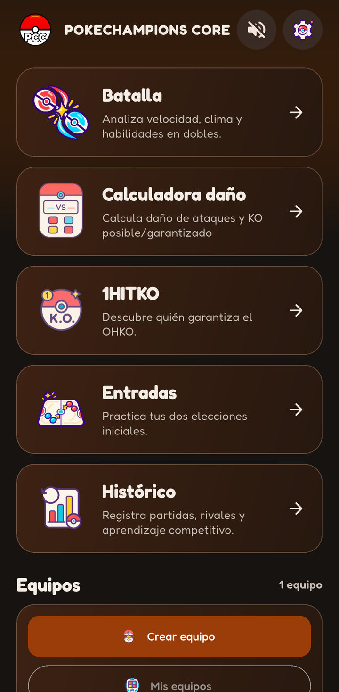</a>
<a href="../media/screenshots/versus-result.png">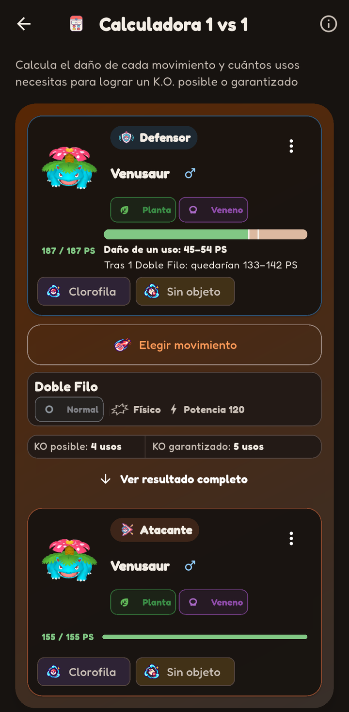</a>

- **Inicio · Emulador Android.** Logo actual y acceso a las herramientas en tema oscuro.
- **Versus · Emulador Android.** Doble Filo: 45–54 PS de daño, con usos para KO posible y garantizado.

## Escenarios y búsqueda

<a href="../media/screenshots/battle.png">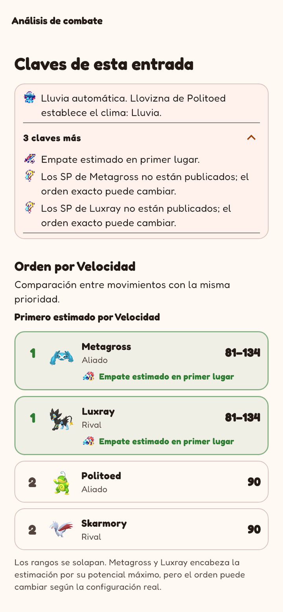</a>
<a href="../media/screenshots/1hitko-results.png">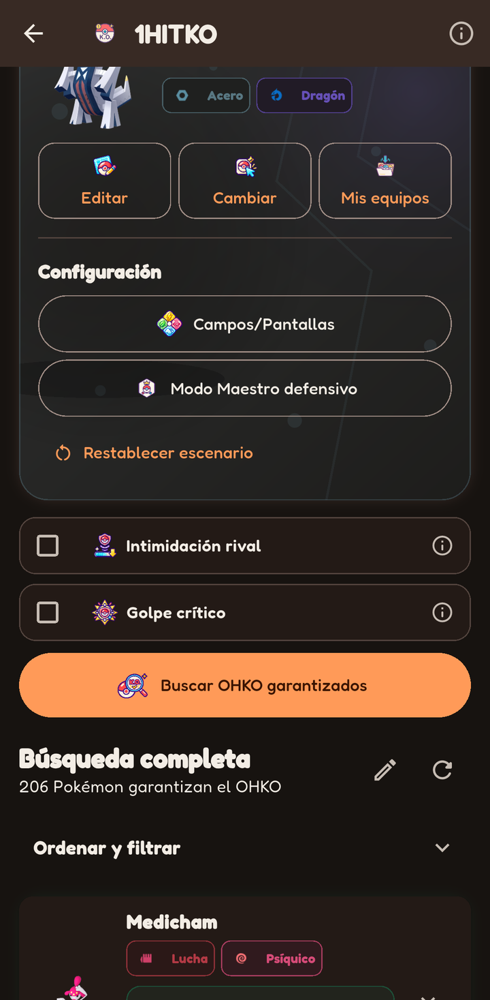</a>

- **Batalla · HOST.** Análisis real de lluvia de entrada y velocidad; los SP desconocidos producen rangos y un empate estimado.
- **1HITKO · Emulador Android.** Vista desplazada tras completar la búsqueda: 206 candidatos en este escenario y acceso a ordenación/filtros. La cifra no es un total universal.

## Equipos y procedencia

<a href="../media/screenshots/team-coverage.png">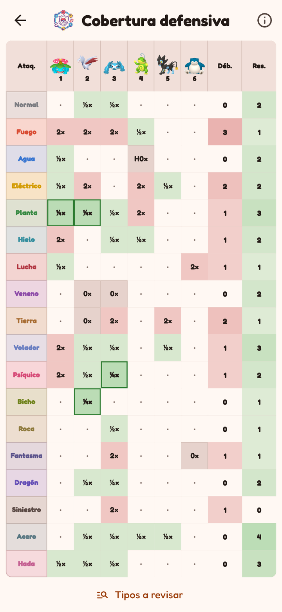</a>
<a href="../media/screenshots/tournaments.png">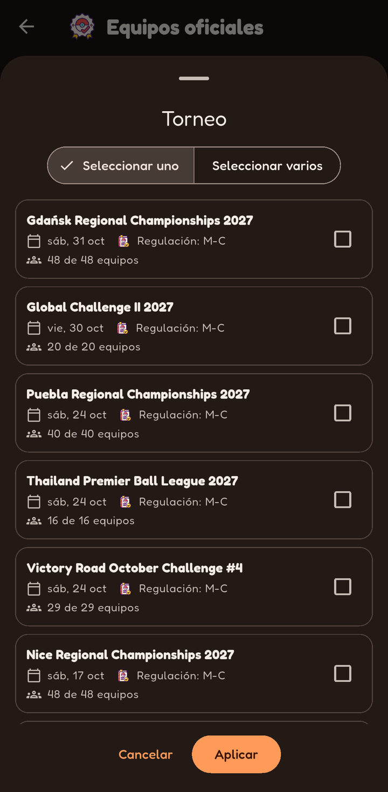</a>

- **Cobertura defensiva · HOST.** Matriz de un equipo de ejemplo con seis integrantes: debilidades, resistencias y respuestas por tipo.
- **Torneos · Emulador Android.** Selector de torneos con fecha, regulación histórica y selección múltiple. Los años 2027 pertenecen a los nombres oficiales de la temporada.

## Configuraciones y consulta

<a href="../media/screenshots/notes.png">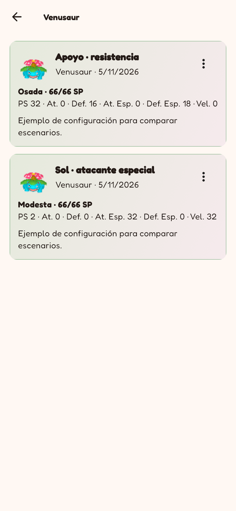</a>
<a href="../media/screenshots/library.png">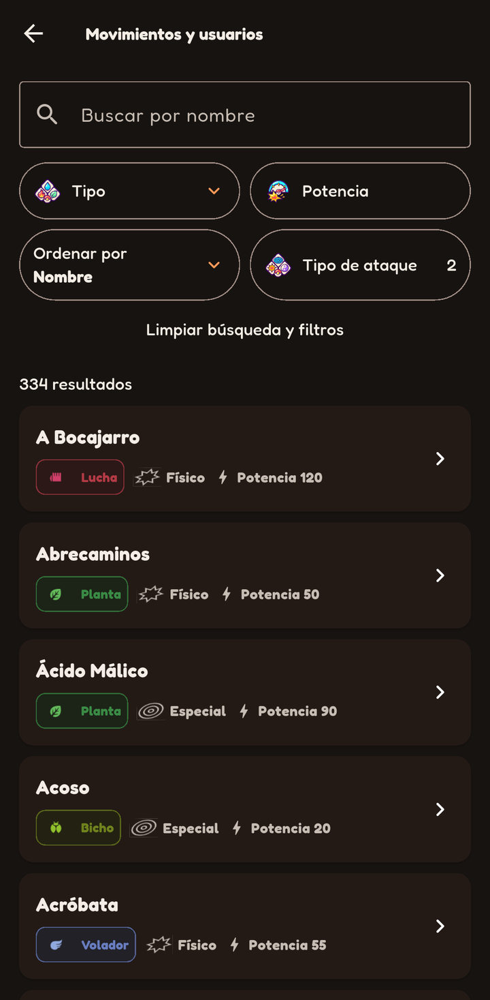</a>

- **Notas · HOST.** Dos configuraciones ficticias de Venusaur en su grupo, con naturaleza y reparto SP. No son recomendaciones competitivas.
- **Biblioteca · Emulador Android.** Movimientos y usuarios con dos categorías aplicadas: 334 resultados en esta selección.

## Demostraciones históricas en vídeo

Estos siete MP4 sin audio se prepararon en **septiembre de 2026**, antes de esta revisión. Se conservan byte a byte y no se ha verificado la compilación exacta de la app. Muestran recorridos anteriores, no acreditan novedades de 1.0.1 ni su rendimiento actual. Pulsa una miniatura o enlace de vídeo; no hay reproducción automática.

<a href="../media/demos/versus.mp4">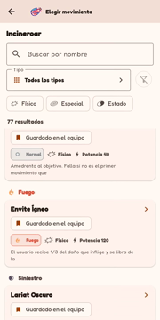</a>
<a href="../media/demos/ev-lab.mp4">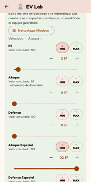</a>
<a href="../media/demos/1hitko.mp4">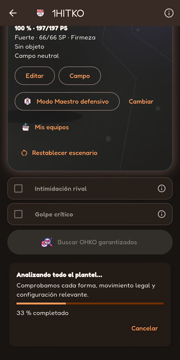</a>
<a href="../media/demos/team-builder.mp4">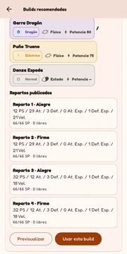</a>
<a href="../media/demos/entradas.mp4">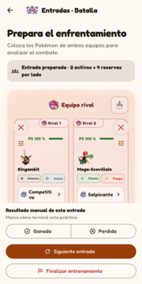</a>
<a href="../media/demos/history.mp4">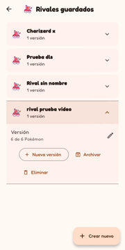</a>
<a href="../media/demos/languages.mp4">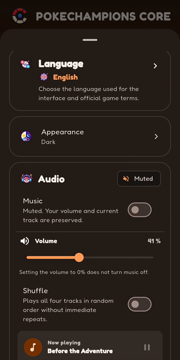</a>

| Demo | Duración | Contexto |
| --- | ---: | --- |
| [Versus](../media/demos/versus.mp4) | 12,6 s | 22/09/2026 · compilación no verificada |
| [EV Lab](../media/demos/ev-lab.mp4) | 16,8 s | 22/09/2026 · compilación no verificada |
| [1HITKO](../media/demos/1hitko.mp4) | 13 s | 17/09/2026 · compilación no verificada |
| [Equipos y builds](../media/demos/team-builder.mp4) | 21 s | 22/09/2026 · compilación no verificada |
| [Entradas](../media/demos/entradas.mp4) | 10 s | 22/09/2026 · compilación no verificada |
| [Histórico](../media/demos/history.mp4) | 9,2 s | 22/09/2026 · compilación no verificada |
| [Idiomas](../media/demos/languages.mp4) | 13,9 s | 22/09/2026 · compilación no verificada |

Los resultados de Entradas e Histórico de las demos se introducen manualmente. El material histórico puede mostrar iconos y controles antiguos. Las funciones actuales se describen en [Funciones](FEATURES.md); el manifiesto multimedia no certifica la exactitud de cálculo.

[Validación](VALIDATION.md) · [Inventario multimedia](../media/README.md) · [Derechos](../NOTICE.md)
