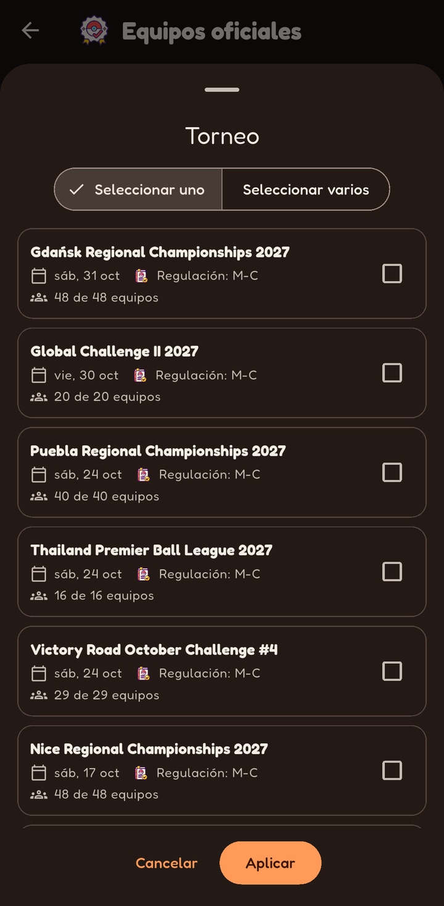
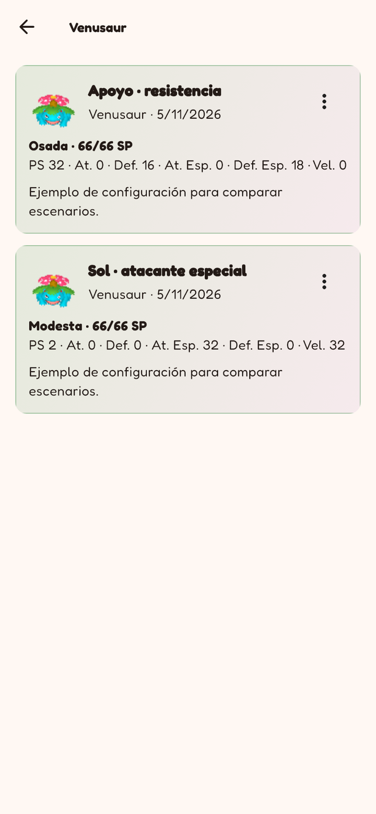
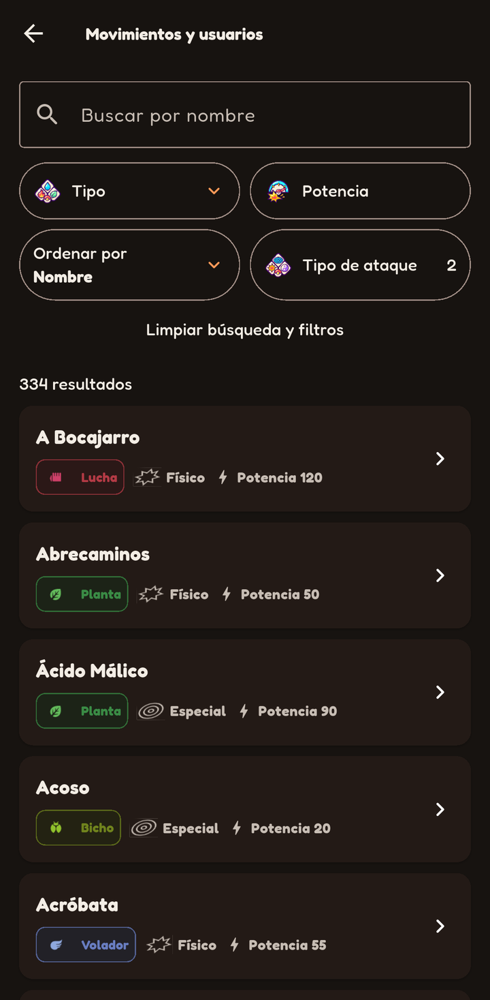

<a href="GALLERY.md">Español</a> · <a href="GALLERY.en.md">English</a> · <a href="GALLERY.fr.md">Français</a> · <a href="GALLERY.de.md">Deutsch</a> · <a href="GALLERY.it.md">Italiano</a> · <strong>Português</strong> · <a href="GALLERY.ja.md">日本語</a> · <a href="GALLERY.ko.md">한국어</a>

# PokeChampions Core · Galeria

[← Apresentação](../README.pt.md) · [Funcionalidades — inglês](FEATURES.en.md) · [Documentação — inglês](README.en.md)

Oito capturas autênticas de **5 de novembro de 2026**, com interface em espanhol. **Emulador Android** identifica a versão 1.0.1/46 em API 36 x86_64; **HOST** identifica widgets Flutter reais renderizados no Windows a partir do código dessa versão, com dados fictícios. Não foi usado um telemóvel físico nesta série. Seleciona uma imagem para a veres na resolução completa.

Só foram retiradas as barras de sistema das imagens do emulador. As imagens HOST não contêm elementos de sistema Android. Todas foram reduzidas, nunca ampliadas; nenhuma interface ou resultado foi reconstruído. [Origem e tratamento — inglês](../media/README.en.md).

## Início e dano

- **Início · Emulador Android.** Logótipo atual e atalhos das ferramentas no tema escuro.
- **Versus · Emulador Android.** Double-Edge: 45–54 HP de dano, com utilizações para KO possível e garantido.

## Cenários e pesquisa

- **Batalha · HOST.** Análise real do clima de entrada e da Velocidade; SP desconhecidos produzem intervalos e um empate estimado.
- **1HITKO · Emulador Android.** Vista deslocada após a pesquisa: 206 candidatos neste cenário, com ordenação e filtros. Não é uma contagem universal.

## Equipas e origem

- **Cobertura defensiva · HOST.** Matriz de uma equipa de exemplo com seis membros: fraquezas, resistências e respostas por tipo.
- **Torneios · Emulador Android.** Seletor de torneios com datas, regulamento histórico e seleção múltipla. As indicações de 2027 pertencem aos nomes oficiais dos eventos da época.

## Configurações e consulta

- **Notas · HOST.** Duas configurações fictícias de Venusaur no seu grupo, com natureza e SP. Não são recomendações competitivas.
- **Biblioteca · Emulador Android.** Movimentos e Pokémon que os aprendem, com duas categorias aplicadas: 334 resultados nesta seleção.

## Demonstrações de vídeo históricas

Estes sete vídeos MP4 sem áudio foram preparados em **setembro de 2026**. Os ficheiros mantêm os mesmos bytes; as builds exatas da aplicação não estão verificadas. Mostram percursos anteriores, não novidades de 1.0.1 nem desempenho atual. Seleciona uma miniatura ou ligação; não há reprodução automática.

| Demo | Duração | Contexto |
| --- | ---: | --- |
| [Versus](../media/demos/versus.mp4) | 12.6 s | 22/09/2026 · build não verificada |
| [EV Lab](../media/demos/ev-lab.mp4) | 16.8 s | 22/09/2026 · build não verificada |
| [1HITKO](../media/demos/1hitko.mp4) | 13 s | 17/09/2026 · build não verificada |
| [Equipas e configurações](../media/demos/team-builder.mp4) | 21 s | 22/09/2026 · build não verificada |
| [Treino de leads](../media/demos/entradas.mp4) | 10 s | 22/09/2026 · build não verificada |
| [Histórico](../media/demos/history.mp4) | 9.2 s | 22/09/2026 · build não verificada |
| [Idiomas](../media/demos/languages.mp4) | 13.9 s | 22/09/2026 · build não verificada |

Os resultados do treino de leads e do histórico são introduzidos manualmente. Os conteúdos antigos podem mostrar ícones e controlos anteriores. O manifesto multimédia não certifica a precisão dos cálculos.

[Validação — inglês](VALIDATION.en.md) · [Inventário multimédia — inglês](../media/README.en.md) · [Direitos — inglês](../NOTICE.en.md)
