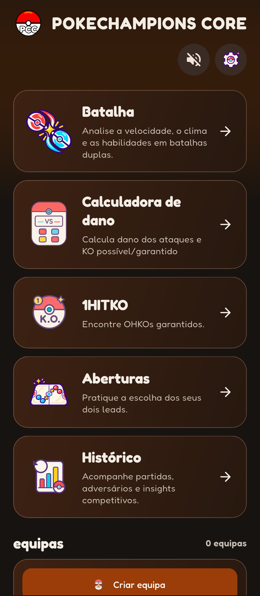
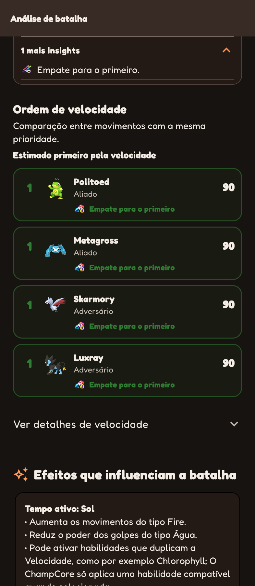
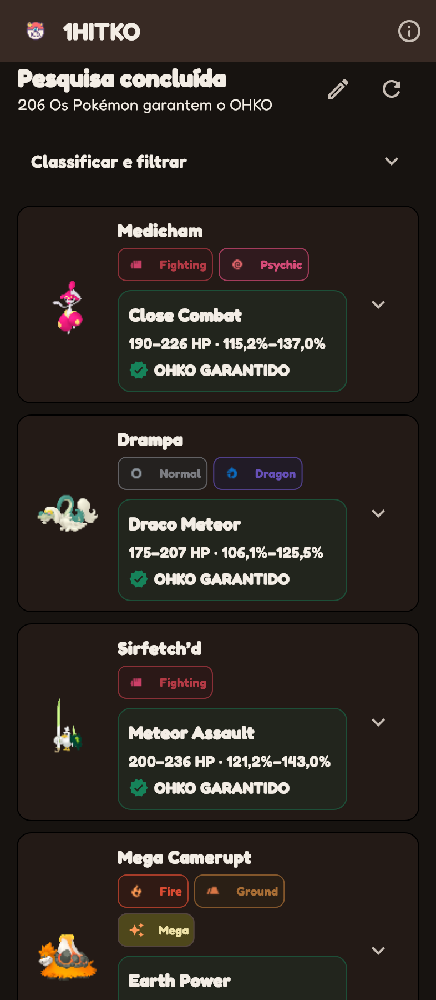
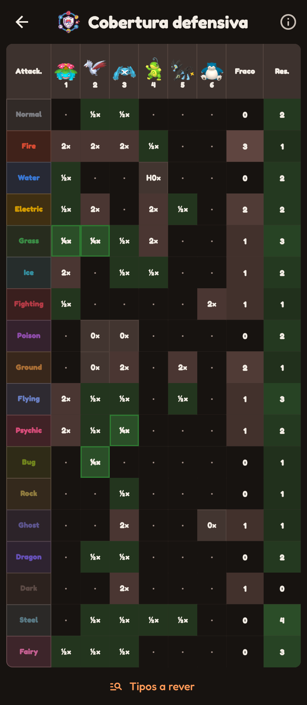
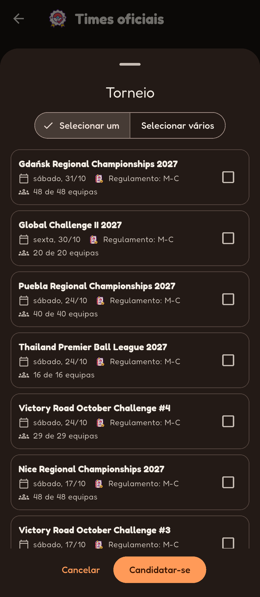
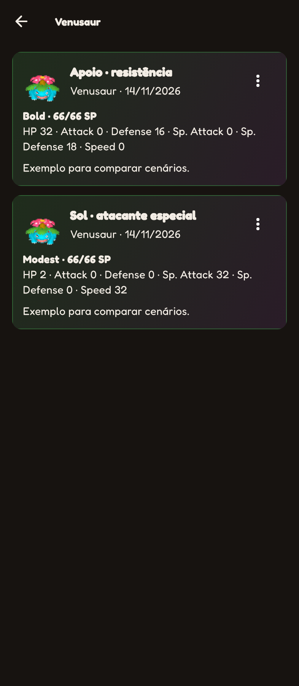
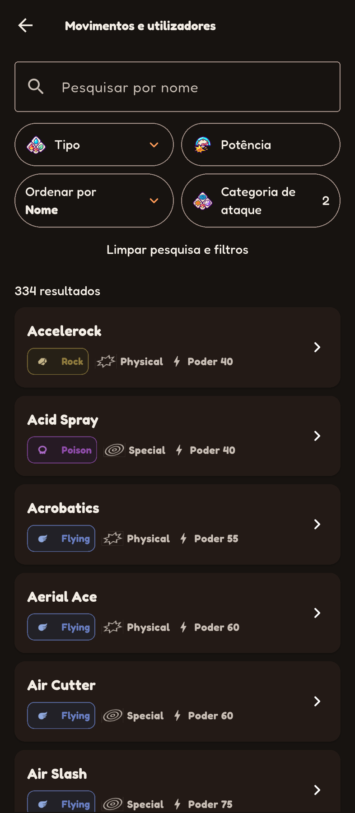

<a href="GALLERY.md">Español</a> · <a href="GALLERY.en.md">English</a> · <a href="GALLERY.fr.md">Français</a> · <a href="GALLERY.de.md">Deutsch</a> · <a href="GALLERY.it.md">Italiano</a> · <strong>Português</strong> · <a href="GALLERY.ja.md">日本語</a> · <a href="GALLERY.ko.md">한국어</a>

# PokeChampions Core · Galeria

[← Apresentação](../README.pt.md) · [Funcionalidades — inglês](FEATURES.en.md) · [Documentação — inglês](README.en.md)

Oito novas capturas de **14 de novembro de 2026**, versão **1.0.1**, com interface em **português de Portugal (pt-PT)**. **HOST** identifica widgets Flutter reais no Windows, com os catálogos e o motor desta versão e dados sintéticos isolados. **Emulador Android** identifica a release 1.0.1/46 em API 36 x86_64. Cada legenda e o manifesto indicam a origem; nenhuma imagem provém de um telemóvel físico.

Os mesmos Pokémon e configurações são usados nos oito idiomas. Só se aplica o recorte das barras de sistema quando necessário, redução proporcional e compressão WebP. Não há interfaces geradas nem tradução de píxeis. [Casos e limites — inglês](SCENARIOS.en.md) · [Origem — inglês](../media/README.en.md).

## Início e dano

- **Início · Android emulator.** Logótipo atual e ferramentas no tema escuro.
- **Versus · HOST.** Venusaur usa Giga Drain contra Blastoise: 84–98 HP e KO possível e garantido em duas utilizações calculadas.

## Cenários e pesquisa

- **Batalha · HOST.** Velocidade conhecida e sol selecionado manualmente num cenário de combate a pares. Não executa turnos.
- **1HITKO · HOST.** Pesquisa concluída contra Archaludon: 206 candidatos neste cenário, com filtros e ordenação. Não é um total universal.

## Equipas e origem

- **Cobertura defensiva · HOST.** Matriz defensiva de uma equipa sintética de seis membros: fraquezas, resistências e imunidades.
- **Torneios · Android emulator.** Catálogo de torneios incluído, com datas e regulamentos históricos. Os nomes de época podem incluir 2027.

## Configurações e consulta

- **Notas · HOST.** Duas configurações sintéticas de Venusaur, com natureza e SP. Não são recomendações competitivas.
- **Biblioteca · Android emulator.** Movimentos e utilizadores com Physical e Special selecionados: 334 resultados neste catálogo. Os termos oficiais retidos mantêm-se em inglês.

## Demonstrações de vídeo históricas

Estes sete vídeos MP4 sem áudio foram preparados em **setembro de 2026**. Os ficheiros mantêm os mesmos bytes; as builds exatas da aplicação não estão verificadas. Mostram percursos anteriores, não novidades de 1.0.1 nem desempenho atual. Seleciona uma miniatura ou ligação; não há reprodução automática.

| Demo | Duração | Contexto |
| --- | ---: | --- |
| [Versus](../media/demos/versus.mp4) | 12.6 s | 22/09/2026 · build não verificada |
| [EV Lab](../media/demos/ev-lab.mp4) | 16.8 s | 22/09/2026 · build não verificada |
| [1HITKO](../media/demos/1hitko.mp4) | 13 s | 17/09/2026 · build não verificada |
| [Equipas e configurações](../media/demos/team-builder.mp4) | 21 s | 22/09/2026 · build não verificada |
| [Treino de leads](../media/demos/entradas.mp4) | 10 s | 22/09/2026 · build não verificada |
| [Histórico](../media/demos/history.mp4) | 9.2 s | 22/09/2026 · build não verificada |
| [Idiomas](../media/demos/languages.mp4) | 13.9 s | 22/09/2026 · build não verificada |

Os resultados do treino de leads e do histórico são introduzidos manualmente. Os conteúdos antigos podem mostrar ícones e controlos anteriores. O manifesto multimédia não certifica a precisão dos cálculos.

[Validação — inglês](VALIDATION.en.md) · [Inventário multimédia — inglês](../media/README.en.md) · [Direitos — inglês](../NOTICE.en.md)
